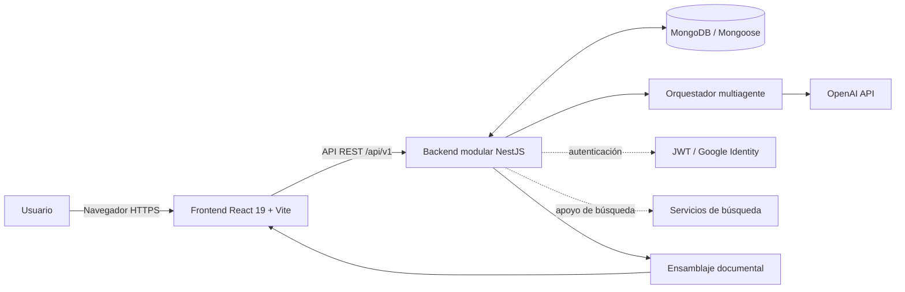
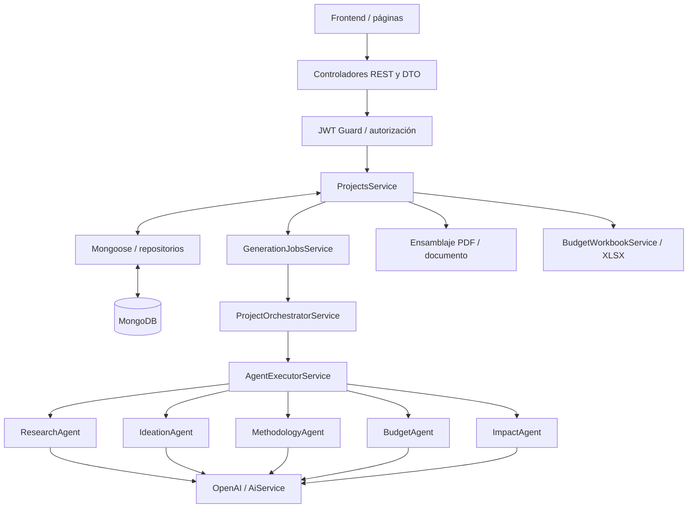
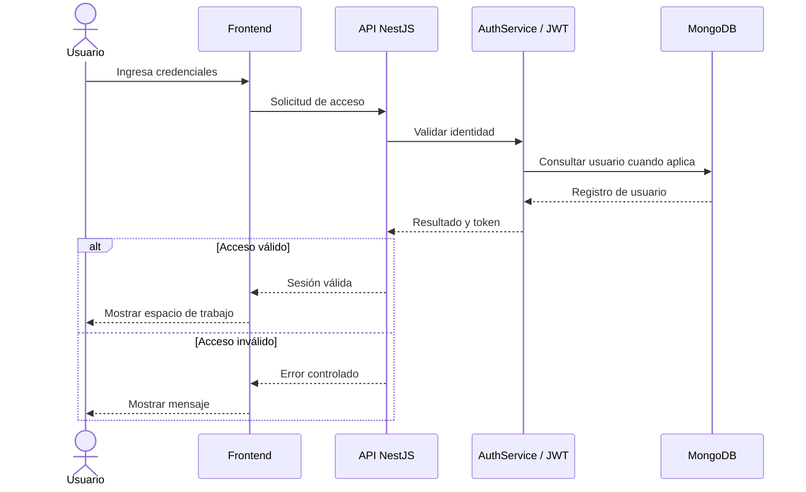
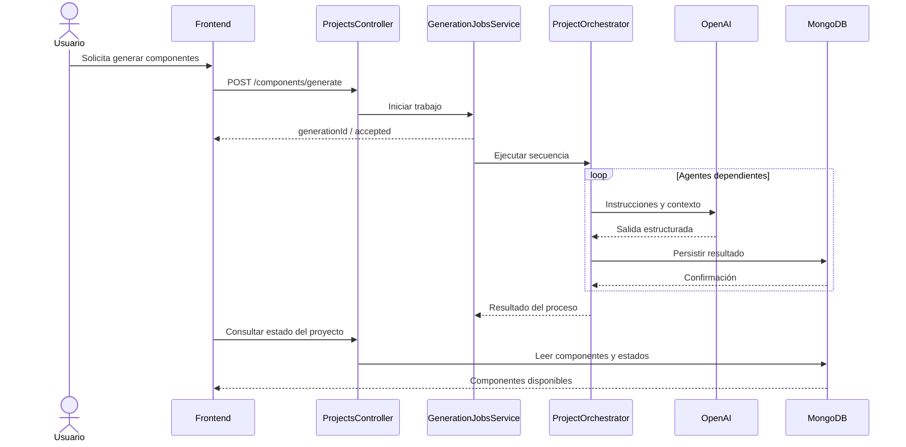
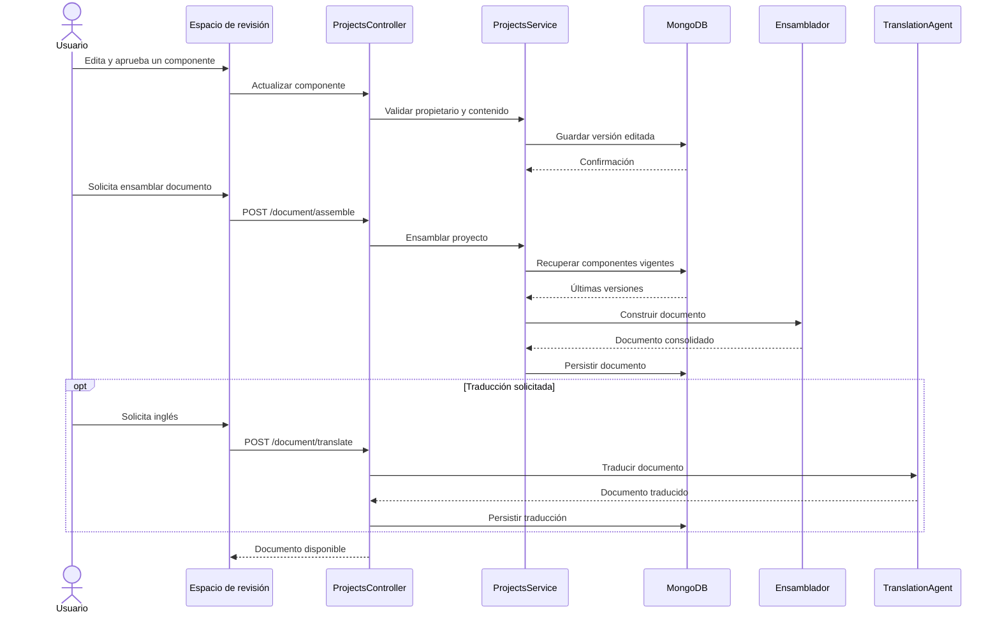
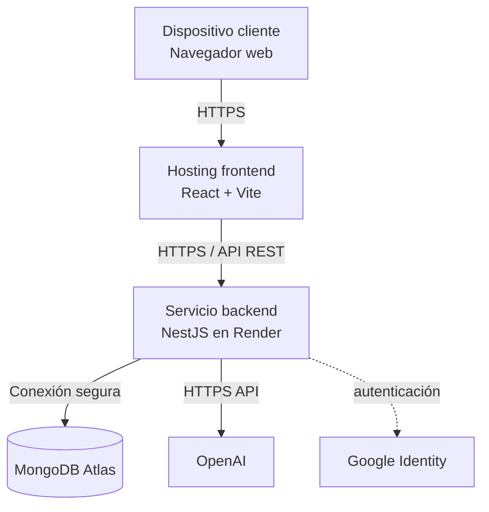

# ÁGORA
## Informe final del proyecto

**Sistema multiagente basado en inteligencia artificial generativa para apoyar la formulación de proyectos de Ciencia, Tecnología e Innovación (CTeI)**

**Documento de cierre académico — noviembre de 2026**

---

## Resumen

La formulación de proyectos de Ciencia, Tecnología e Innovación (CTeI) exige transformar una idea inicial en una propuesta estructurada, con relaciones consistentes entre el problema, los antecedentes, los objetivos, las actividades, la metodología, el cronograma, el presupuesto, los beneficiarios, los riesgos y los impactos esperados. Para estudiantes universitarios con experiencia limitada en formulación, este proceso puede convertirse en una barrera: además de redactar, deben identificar la información necesaria, reconocer vacíos y mantener la coherencia entre apartados que dependen unos de otros.

Como respuesta, se desarrolló **Ágora**, una aplicación web con características de Producto Mínimo Viable (MVP) que utiliza inteligencia artificial generativa y un sistema multiagente especializado para acompañar al usuario desde la descripción inicial de una idea hasta la elaboración de un documento preliminar de proyecto CTeI. La solución integra captura guiada de información, diagnóstico del contexto, generación de contenido, revisión y edición humana, persistencia del progreso, ensamblaje documental, traducción del español al inglés y exportación.

La versión implementada genera trece componentes: marco teórico, estado del arte, planteamiento del problema, antecedentes, bibliografía, actividades, objetivos SMART, cronograma, metodología, presupuesto, beneficiarios, riesgos e impactos esperados. La generación se distribuye entre cinco agentes de formulación —ResearchAgent, IdeationAgent, MethodologyAgent, BudgetAgent e ImpactAgent— coordinados secuencialmente por un orquestador. Un TranslationAgent complementa el flujo para traducir el documento consolidado. Antes de producir metodología y presupuesto, el usuario responde nueve preguntas operativas para aportar información concreta sobre ejecución, participantes, recursos, tiempos, entregables, verificación, costos y condiciones especiales.

La implementación utiliza React 19, TypeScript y Vite en el frontend; NestJS y TypeScript en el backend; MongoDB con Mongoose para persistencia; y la API de OpenAI para las operaciones generativas. El sistema incorpora autenticación, autorización por propietario, validación de entradas, estados de proyecto, persistencia incremental y generación de componentes en segundo plano dentro del proceso del backend. También contempla exportación documental, traducción, regeneración controlada y exportación del presupuesto a Excel.

La evidencia disponible incluye una evaluación comparativa experta de la interfaz —84,3/100 para la versión implementada frente a 66,4/100 para el prototipo inicial— y un registro de 117 pruebas automatizadas: 57 frontend, 58 unitarias backend y 2 pruebas end-to-end. Adicionalmente, tres pilotajes comparativos desarrollados con Krea Proyectos evaluaron la conexión estructural de los componentes, la eficiencia temporal y la eficiencia económica. En la evaluación estructural, Ágora obtuvo 89,8/100, frente a 62,6/100 de IA general y 67,2/100 de IA con prompt estructurado. En el comparativo de tiempos, el promedio ponderado estimado fue de 16 horas para Ágora, frente a 54,4 horas con IA general, equivalente a una reducción del 70,6 %. En el escenario económico promedio, el costo estimado fue de COP 842.592 frente a una base comparable de COP 5.555.000, una reducción estimada del 84,8 %. Estos resultados corresponden a muestras y supuestos específicos y no constituyen una validación estadística externa ni una garantía de resultados para cualquier proyecto. La evidencia disponible respalda el avance y la validación comparativa inicial, pero no demuestra preparación para cargas masivas. La revisión del código también permite identificar limitaciones que deben declararse: el trabajo generativo se ejecuta en segundo plano mediante un mecanismo en memoria del proceso, por lo que aún requiere una cola durable y mecanismos de recuperación más robustos para operación sostenida.

En conclusión, Ágora alcanzó el objetivo de construir un MVP funcional y demostrable que organiza la formulación de proyectos CTeI mediante agentes especializados y mantiene al usuario como responsable de revisar y aprobar el contenido. Los pilotajes comparativos aportan evidencia inicial de ventajas en conexión estructural, tiempo y costo estimado frente a las alternativas evaluadas, sin sustituir la revisión humana ni las validaciones adicionales. El proyecto deja una base técnica operativa y una ruta de evolución definida: ampliar las pruebas integrales, medir rendimiento y costos en condiciones de uso, fortalecer la ejecución de trabajos, mejorar observabilidad y verificar la calidad de las referencias y del contenido generado.

## Abstract

The formulation of Science, Technology and Innovation (STI) projects requires transforming an initial idea into a structured proposal in which the problem, background, objectives, activities, methodology, schedule, budget, beneficiaries, risks and expected impacts remain logically connected. For university students with limited experience in project formulation, this process can be challenging because they must identify the required information, detect missing data and preserve consistency across interdependent sections.

To address this problem, **Ágora** was developed as a web application with Minimum Viable Product (MVP) characteristics. It combines generative artificial intelligence with a specialized multi-agent system to guide users from an initial idea to a preliminary STI project document. Its workflow includes guided information collection, context diagnosis, content generation, human review and editing, progress persistence, document assembly, Spanish-to-English translation and export.

The implemented version generates thirteen components: theoretical framework, state of the art, problem statement, background, bibliography, activities, SMART objectives, schedule, methodology, budget, beneficiaries, risks and expected impacts. Five formulation agents are coordinated by an orchestrator, while a separate translation agent handles the consolidated document. An additional nine-question execution-details stage is required before methodology and budget generation.

The system uses React 19, TypeScript and Vite for the frontend; NestJS and TypeScript for the backend; MongoDB and Mongoose for persistence; and the OpenAI API for generative operations. Available validation evidence includes an expert comparative interface score of 84.3/100 for the implemented version versus 66.4/100 for the original prototype, as well as 117 automated tests reported across frontend, backend unit and end-to-end suites. In addition, three comparative pilot exercises conducted with Krea Proyectos examined structural connection, formulation time and estimated costs. Ágora obtained 89.8/100 in structural connection, compared with 62.6/100 for general-purpose AI and 67.2/100 for AI with a structured prompt. The weighted time estimate was 16 hours for Ágora versus 54.4 hours for general-purpose AI, a 70.6% reduction. In the average cost scenario, the estimated cost was COP 842,592 compared with a comparable baseline of COP 5,555,000, an estimated reduction of 84.8%. These results are limited to the samples, assumptions and scenarios evaluated; they do not establish statistical effectiveness across the wider population or production-scale readiness.

Ágora therefore achieves its central project objective: providing a guided, persistent and human-supervised workflow for producing a preliminary STI project document. The comparative pilots provide initial evidence of advantages in structural connection, time and estimated cost against the evaluated alternatives, while further work should focus on end-to-end validation, measurement under real operating conditions, durable background-job execution, observability and verification of generated references and content.

---

# 1. Introducción

La formulación de proyectos de Ciencia, Tecnología e Innovación constituye una actividad necesaria en contextos universitarios, investigativos y de emprendimiento. Permite convertir necesidades, problemas u oportunidades en iniciativas que pueden analizarse, evaluarse y posteriormente ejecutarse. Para lograrlo no basta con redactar apartados aislados: se requiere una estructura que conecte el problema con los objetivos, los objetivos con las actividades, las actividades con la metodología y el cronograma, y estos con los recursos, costos y resultados esperados.

En estudiantes que se aproximan por primera vez a este proceso, la dificultad aparece desde el inicio. Aunque pueden tener una idea clara, no siempre conocen los componentes que debe contener una propuesta, la información que deben recopilar ni la manera de mantener relaciones lógicas entre sus secciones. Esta situación se conoce comúnmente como la barrera de la “hoja en blanco”, pero en el contexto del proyecto representa un problema más amplio: la falta de una ruta guiada para convertir información dispersa en una formulación organizada.

Las herramientas de inteligencia artificial generativa facilitan la producción y transformación de texto, pero un asistente de propósito general no necesariamente ofrece un procedimiento especializado para formular un proyecto CTeI. El usuario debe saber qué preguntar, qué estructura solicitar y cómo comprobar que las respuestas de diferentes interacciones sean coherentes. Ágora aborda esta brecha mediante un flujo guiado, agentes con responsabilidades delimitadas y un espacio de revisión en el que la persona conserva el control sobre el documento.

El proyecto evolucionó desde un prototipo de interfaz y servicios simulados hacia una aplicación web conectada a un backend real, persistencia de datos e integración con modelos generativos. En su estado final documentado, el núcleo funcional del MVP está implementado y el trabajo se concentra en validación, corrección de incidencias y fortalecimiento operativo. Por tanto, este informe describe tanto las capacidades construidas como las limitaciones que permanecen abiertas, evitando presentar como comprobadas aquellas propiedades que todavía requieren mediciones.

## 1.1 Justificación

Desde la dimensión académica, Ágora busca disminuir la dificultad de iniciar una propuesta y permitir que el estudiante concentre una mayor parte de su esfuerzo en comprender, revisar y mejorar la idea. La plataforma no reemplaza el criterio académico ni la responsabilidad del autor; proporciona un punto de partida estructurado que debe ser contrastado y ajustado.

Desde la dimensión práctica, la solución organiza la formulación en pasos. El usuario aporta información inicial, responde preguntas de aclaración, revisa componentes y conserva su progreso. Esta secuencia reduce la necesidad de diseñar manualmente instrucciones para un asistente generalista y facilita retomar un proyecto que no se complete en una sola sesión.

Desde la dimensión tecnológica, el proyecto permite aplicar una arquitectura modular, integración con modelos de lenguaje, orquestación de agentes, persistencia, generación documental y validación de software. Su aporte no consiste en crear un nuevo modelo de lenguaje, sino en organizar capacidades existentes en un producto especializado para la formulación inicial de proyectos CTeI.

## 1.2 Organización del documento

El informe presenta los fundamentos conceptuales y el problema abordado; establece objetivos y alcance; compara soluciones relacionadas y alternativas técnicas; describe la solución, metodología, requerimientos, arquitectura e implementación; y documenta despliegue, validación, resultados, limitaciones y trabajo futuro. Los diagramas incluidos representan la arquitectura lógica y los principales recorridos del sistema, mientras que las afirmaciones sobre pruebas se limitan a la evidencia registrada en el proyecto y en el segundo informe.

# 2. Marco conceptual

## 2.1 Proyectos de Ciencia, Tecnología e Innovación

Los proyectos CTeI reúnen actividades articuladas para alcanzar objetivos mediante una metodología y recursos definidos. Esta estructura justifica que Ágora no genere únicamente texto libre, sino que organice componentes que deben guardar correspondencia entre sí. La definición de Minciencias constituye el referente institucional utilizado para orientar la estructura general del proyecto [1].

Ágora se limita a producir un borrador inicial. No implementa un procedimiento institucional completo ni determina si una propuesta cumple los criterios de una convocatoria específica. La evaluación técnica, financiera, jurídica y científica continúa siendo responsabilidad de los usuarios y de los evaluadores competentes.

## 2.2 Inteligencia artificial generativa y modelos de lenguaje

La inteligencia artificial generativa permite producir contenido nuevo a partir de instrucciones y contexto. Los modelos de lenguaje de gran tamaño procesan y generan lenguaje natural y pueden utilizarse para resumir, estructurar, transformar y redactar información. En Ágora se emplean para apoyar el diagnóstico y la generación de componentes del proyecto.

Estas tecnologías presentan riesgos: pueden producir datos incorrectos, inferencias no justificadas o referencias que no existen. NIST identifica la generación de contenido falso o erróneo presentado con apariencia de confianza como uno de los riesgos relevantes de la IA generativa [2]. Por esta razón, la plataforma presenta los resultados como propuestas que deben revisarse y no como afirmaciones certificadas.

## 2.3 Sistemas multiagente y orquestación

Un sistema multiagente distribuye una tarea compleja entre componentes especializados que colaboran mediante entradas, salidas y dependencias definidas. En Ágora, la especialización es funcional: cada agente se encarga de un conjunto delimitado de componentes y el orquestador determina el orden de ejecución y la información que recibe cada uno.

El código organiza cinco agentes de formulación en la secuencia Investigación, Ideación, Metodología, Presupuesto e Impacto. Las dependencias se expresan explícitamente: Ideación requiere Investigación; Metodología requiere Investigación e Ideación; Presupuesto requiere Ideación y Metodología; e Impacto recibe los resultados anteriores. El agente de traducción opera sobre el documento consolidado y no forma parte de los cinco agentes que producen los trece componentes.

## 2.4 Human-in-the-loop

El enfoque human-in-the-loop mantiene a una persona dentro del proceso de decisión y validación. En Ágora se materializa mediante la revisión, edición, guardado y aprobación de los componentes. La generación automática no convierte el contenido en definitivo: el usuario debe verificar su pertinencia, exactitud y correspondencia con la realidad del proyecto.

Este principio resulta especialmente importante para bibliografía, presupuesto, metodología e impactos, cuyos contenidos pueden implicar decisiones académicas o económicas. La herramienta facilita una primera elaboración, pero no certifica la existencia de las fuentes ni la viabilidad de los recursos propuestos.

## 2.5 Producto mínimo viable

El MVP corresponde a una versión funcional que permite demostrar el valor central del producto. Para Ágora, ese valor consiste en recorrer el proceso desde la idea y la recopilación de contexto hasta la generación, revisión y exportación de un documento estructurado. Las funcionalidades secundarias que no impiden demostrar ese recorrido pueden evolucionar posteriormente.

## 2.6 Arquitectura monolítica modular

Una arquitectura monolítica modular concentra la aplicación backend en una unidad de despliegue, pero separa internamente sus responsabilidades. Ágora adopta este enfoque con NestJS y módulos para autenticación, proyectos, IA, orquestación, usuarios, configuración y salud. Esta decisión evita introducir prematuramente la complejidad de desplegar múltiples servicios, manteniendo límites funcionales que facilitan el mantenimiento.

La arquitectura no debe confundirse con una solución de alta disponibilidad. El sistema aún requiere fortalecer la ejecución de trabajos largos, la recuperación ante reinicios, la observabilidad y las pruebas de carga antes de afirmar que está preparado para un uso masivo [5].

## 2.7 Completitud, coherencia y usabilidad

La completitud se refiere a que los componentes requeridos estén presentes y no vacíos. La coherencia se refiere a relaciones lógicas básicas, como la correspondencia entre problema y objetivos, objetivos y actividades, metodología y ejecución, y recursos y presupuesto. Estas comprobaciones no equivalen a una evaluación científica exhaustiva.

La usabilidad considera si el usuario comprende las preguntas, puede navegar, revisar y editar el contenido y completar el flujo sin asistencia constante del equipo desarrollador. En Ágora se evalúa mediante pruebas con usuarios y una comparación experta de interfaces.

# 3. Planteamiento del problema

## 3.1 Descripción del problema

Los estudiantes universitarios pueden identificar necesidades u oportunidades, pero enfrentar dificultades para transformarlas en propuestas estructuradas de CTeI. La formulación requiere conocer los apartados necesarios, identificar los datos que hacen falta y establecer dependencias entre los componentes. La dificultad aumenta cuando el usuario no tiene experiencia previa o desconoce los criterios de organización de una propuesta.

Entre las causas identificadas se encuentran la experiencia limitada en formulación, el desconocimiento de la estructura de los proyectos, la dificultad para reconocer información faltante, la falta de orientación metodológica y la dependencia de conocimientos previos para utilizar asistentes de IA generales. Como consecuencia, pueden aparecer propuestas incompletas, apartados inconexos, tiempos elevados de elaboración o abandono temprano de ideas.

El problema central se define de la siguiente manera: **los estudiantes universitarios presentan dificultades para transformar ideas iniciales en propuestas estructuradas y coherentes de proyectos CTeI, debido a la limitada experiencia en formulación, la dificultad para identificar y relacionar la información necesaria y la ausencia de un mecanismo guiado que acompañe progresivamente la construcción de sus componentes.**

## 3.2 Restricciones y supuestos de diseño

| Categoría | Restricción o supuesto | Implicación |
|---|---|---|
| Tiempo y equipo | Desarrollo dentro de un periodo académico y con equipo reducido. | Priorizar el flujo esencial y evitar complejidad innecesaria. |
| Proveedor de IA | La generación depende de OpenAI y de su disponibilidad. | Una falla externa puede retrasar o impedir una operación generativa. |
| Costos | El consumo depende de solicitudes y tokens. | Controlar regeneraciones y medir el costo por generación. |
| Calidad | Los modelos pueden producir contenido incorrecto o no sustentado. | Mantener revisión humana y verificación de referencias. |
| Contexto | La calidad depende de la información aportada por el usuario. | Solicitar datos complementarios antes de metodología y presupuesto. |
| Usuarios de prueba | La validación se ha realizado con grupos reducidos. | No generalizar estadísticamente los resultados. |
| Operación | La ejecución de trabajos se mantiene dentro del proceso backend. | La recuperación y la concurrencia requieren fortalecimiento. |
| Conectividad | Se requiere conexión a internet. | No se contempla operación sin conexión. |
| Alcance académico | El sistema produce borradores. | No certifica viabilidad ni aprobación institucional. |

## 3.3 Alcance

El MVP genera trece apartados: marco teórico, estado del arte, planteamiento del problema, antecedentes, bibliografía, actividades, objetivos SMART, cronograma, metodología, presupuesto, beneficiarios, riesgos e impactos esperados. Esta lista está definida en el registro de componentes del código y determina el orden de presentación del documento.

El flujo incluye autenticación, creación y consulta de proyectos, recopilación de contexto, diagnóstico, generación multiagente, preguntas operativas, revisión, edición, aprobación, persistencia, ensamblaje documental, traducción y exportación. El contexto inicial contempla ocho campos, incluida la duración prevista y una cantidad exacta de objetivos específicos entre dos y cinco. La etapa operativa contiene nueve campos de respuesta.

Quedan fuera del alcance la certificación de viabilidad, la garantía de aprobación en convocatorias, la sustitución de un formulador profesional, la eliminación total de errores generativos, la colaboración simultánea avanzada y la operación masiva de alta disponibilidad. La exportación PDF está documentada como salida consolidada; el código también contiene un servicio de exportación de presupuesto a libro Excel. No se afirma que todos los formatos o integraciones estén disponibles en cada entorno de despliegue sin una prueba específica.

# 4. Objetivos

## 4.1 Objetivo general

Desarrollar una aplicación web funcional con características de producto mínimo viable, basada en inteligencia artificial generativa y un sistema multiagente, que permita recopilar y organizar la información básica de una idea de proyecto CTeI, generar trece componentes estructurales, facilitar su revisión y edición por parte del usuario y consolidarlos en un documento preliminar integrado y exportable.

## 4.2 Objetivos específicos

1. Diseñar e implementar un mecanismo de interacción guiada para recopilar información básica, reconocer datos faltantes y solicitar aclaraciones.
2. Integrar un motor de generación basado en agentes especializados que produzca los trece componentes definidos, utilizando contexto compartido y dependencias entre agentes.
3. Implementar mecanismos para visualizar, editar, guardar y aprobar los componentes, y ensamblar la última versión persistida en un documento consolidado.
4. Validar el funcionamiento del MVP mediante pruebas automatizadas, pruebas funcionales y ejercicios de usabilidad, identificando oportunidades de mejora y limitaciones técnicas.

# 5. Estado del arte y soluciones relacionadas

## 5.1 Asistentes generativos de propósito general

Herramientas como ChatGPT y Gemini permiten generar, reorganizar, resumir y explicar contenido mediante instrucciones en lenguaje natural [6]. Su flexibilidad reduce la barrera de acceso a modelos de lenguaje, pero el usuario debe construir el proceso de formulación, solicitar cada apartado y comprobar la coherencia entre respuestas independientes.

Ágora utiliza capacidades similares, pero las incorpora en un flujo especializado. La diferencia no consiste en afirmar que otras herramientas no pueden producir esos textos, sino en organizar la captura de información, las dependencias, la persistencia y la revisión en una sola experiencia.

## 5.2 Herramientas especializadas en investigación

Elicit se orienta a la búsqueda y síntesis de literatura científica, con mecanismos para extraer información y relacionar afirmaciones con fuentes [7]. Es una herramienta pertinente para tareas de investigación y fundamentación, pero su objetivo no es recorrer de extremo a extremo los componentes de un proyecto CTeI, como cronograma, metodología, presupuesto, riesgos e impactos.

Ágora incluye bibliografía y componentes de fundamentación, aunque no reemplaza una revisión sistemática ni garantiza que las referencias generadas sean correctas. El usuario debe verificar la existencia, pertinencia y exactitud de cada fuente.

## 5.3 Sistemas multiagente basados en LLM

La investigación sobre sistemas multiagente con modelos de lenguaje estudia la distribución de tareas entre agentes, la coordinación y los mecanismos para resolver problemas complejos [8]. Esta línea respalda conceptualmente la separación de responsabilidades, aunque la calidad del resultado depende de la definición de roles, contratos, dependencias y mecanismos de validación.

En Ágora la especialización se implementa mediante cinco agentes de formulación coordinados por código. El orquestador conserva el control del orden y entrega a cada agente las salidas de las dependencias que necesita.

## 5.4 Comparación

| Criterio | Asistentes generales | Elicit | Sistemas multiagente | Ágora |
|---|---|---|---|---|
| Captura guiada CTeI | No especializada | Orientada a literatura | Depende de implementación | Sí |
| Flujo de trece componentes | No predefinido | No | Depende de implementación | Sí |
| Coherencia entre secciones | Depende del usuario | Centrada en evidencia | Depende de orquestación | Contexto y dependencias compartidas |
| Revisión humana | Disponible | Disponible | Depende de implementación | Edición y aprobación |
| Persistencia del proyecto | Depende del producto | Sí, orientada a investigación | Depende de implementación | Sí |
| Bibliografía | Puede generar, requiere verificación | Funcionalidad central | Depende de implementación | Generada y verificable por usuario |
| Exportación del proyecto CTeI | No específica | No es su objetivo central | Depende de implementación | Documento consolidado |
| Preguntas operativas previas | No específicas | No | Depende de implementación | Nueve respuestas requeridas |

## 5.5 Diferenciación de Ágora

La propuesta de valor de Ágora se encuentra en la integración de captura guiada, generación especializada, persistencia, intervención humana y ensamblaje documental. Las preguntas operativas se incorporaron como respuesta a una necesidad identificada durante las pruebas: la información inicial no siempre era suficiente para elaborar una metodología y un presupuesto realistas.

Por ello, la plataforma no busca maximizar el número de agentes, sino distribuir de forma controlada las responsabilidades y mantener una secuencia lógica entre los apartados. Esta decisión también facilita identificar qué componente produjo una salida y qué información previa utilizó.

# 6. Solución propuesta

Ágora es una aplicación web que acompaña al usuario durante la formulación de una propuesta CTeI. El usuario crea un proyecto, proporciona información sobre el problema, alcance, población, ubicación, solución y resultados esperados, además de indicar duración y cantidad de objetivos específicos. El sistema conserva ese contexto y realiza un diagnóstico para identificar vacíos o inconsistencias relevantes.

Una vez confirmado el contexto, el orquestador ejecuta los agentes de formulación en el orden establecido. Investigación produce marco teórico, estado del arte, planteamiento del problema, antecedentes y bibliografía. Ideación genera actividades, objetivos SMART y cronograma. Después de esta etapa, el flujo se detiene para solicitar nueve respuestas operativas; con ellas se habilitan metodología y presupuesto. Impacto produce beneficiarios, riesgos e impactos esperados.

Al finalizar la generación, el usuario puede revisar, editar, guardar y aprobar los componentes. El documento se ensambla con las versiones persistidas, puede traducirse al inglés y exportarse. El usuario mantiene la responsabilidad de verificar el contenido, en especial las fuentes bibliográficas, las cifras presupuestales y las afirmaciones técnicas.

## 6.1 Componentes generados

| Orden | Componente | Agente responsable |
|---:|---|---|
| 1 | Marco teórico | Investigación |
| 2 | Estado del arte | Investigación |
| 3 | Planteamiento del problema | Investigación |
| 4 | Antecedentes | Investigación |
| 5 | Bibliografía | Investigación |
| 6 | Actividades | Ideación |
| 7 | Objetivos SMART | Ideación |
| 8 | Cronograma | Ideación |
| 9 | Metodología | Metodología |
| 10 | Presupuesto | Presupuesto |
| 11 | Beneficiarios | Impacto |
| 12 | Riesgos | Impacto |
| 13 | Impactos esperados | Impacto |

## 6.2 Recopilación de información

El contexto inicial se obtiene mediante preguntas progresivas. En el código se definen ocho campos: problema, alcance inicial, población objetivo, ubicación, solución propuesta, resultados esperados, número de objetivos específicos y duración del proyecto. La cantidad de objetivos se valida como un entero entre dos y cinco, y el flujo impide avanzar mientras falten datos esenciales.

La etapa de ejecución contiene nueve campos: desarrollo de actividades, participantes, ubicación y participantes, recursos requeridos, tiempos y dependencias, entregables, métodos de verificación, información económica conocida y condiciones especiales. Estos datos se solicitan después de Ideación y antes de metodología y presupuesto.

Esta separación permite que los componentes de ejecución no se construyan únicamente a partir de supuestos del modelo. La información adicional mejora el contexto disponible, aunque no garantiza por sí sola que los costos o la metodología sean correctos; estos deben revisarse.

## 6.3 Revisión, regeneración y continuidad

Los proyectos se asocian a un usuario propietario y sus datos se conservan en MongoDB. El usuario puede consultar proyectos anteriores y retomar el trabajo. El sistema también controla la regeneración: el código establece un máximo de tres regeneraciones de fragmentos y una única regeneración completa después de finalizar el proyecto.

La persistencia incremental permite conservar resultados conforme se generan. Sin embargo, la ejecución de trabajos en segundo plano utiliza actualmente un mapa en memoria del proceso backend para registrar trabajos activos. Esto evita duplicar un trabajo activo dentro de una misma instancia, pero no equivale a una cola durable: un reinicio puede interrumpir la ejecución. El sistema contempla marcar trabajos interrumpidos al iniciar el módulo, pero la recuperación automática de una cola persistente sigue siendo una mejora necesaria.

# 7. Metodología de desarrollo

## 7.1 Enfoque iterativo e incremental

El desarrollo siguió un enfoque iterativo e incremental. En una primera etapa se definió la experiencia del usuario y se construyó un prototipo de frontend con React, Vite y TypeScript. Se utilizaron servicios simulados para validar la navegación, formularios, estados y organización de las pantallas sin depender inicialmente del backend definitivo.

Posteriormente se integró el backend modular en NestJS, la persistencia en MongoDB y el proveedor de inteligencia artificial. La lógica generativa se separó en agentes con responsabilidades delimitadas y un orquestador que controla las dependencias. Esta evolución permitió pasar de una demostración de interfaz a un MVP con flujo funcional y persistencia.

En la etapa de cierre, el trabajo se concentró en pruebas, observación de incidencias y ajustes. El ciclo aplicado fue prueba, observación, corrección y nueva prueba. Esta metodología permitió adaptar el producto a hallazgos reales, en lugar de conservar decisiones iniciales que no respondían adecuadamente al uso.

## 7.2 Evolución del flujo multiagente

El flujo actual utiliza cinco agentes de formulación: ResearchAgent, IdeationAgent, MethodologyAgent, BudgetAgent e ImpactAgent. El código define dependencias explícitas y ejecuta los agentes en orden secuencial. El orquestador puede recibir resultados previos y continuar desde el punto correspondiente, lo que permite manejar etapas y pausas del proceso.

El TranslationAgent se utiliza para traducir el documento consolidado. Esta responsabilidad se mantiene separada de la generación de los trece componentes, debido a que la traducción se realiza después del ensamblaje y no necesita repetir el proceso de formulación.

La salida de los agentes se valida mediante esquemas estructurados y se transforma a los componentes internos del proyecto. Esta decisión reduce la dependencia de texto libre y permite que la aplicación trabaje con estructuras conocidas para mostrar, editar y ensamblar la información.

## 7.3 Ajustes derivados de las pruebas

Durante la integración se identificó que el contexto general no aportaba suficiente detalle para representar las condiciones reales de ejecución. Se incorporaron nueve preguntas obligatorias antes de metodología y presupuesto, y se ajustaron las instrucciones del agente de presupuesto para mejorar la relación entre objetivos, actividades, recursos y costos.

También se realizaron cambios de interfaz y navegación: reorganización del inicio de sesión, corrección de lentitud percibida en el acceso, ajustes de espaciado, incorporación de controles para regresar, acceso al inicio durante el proyecto, persistencia al abandonar temporalmente el flujo, límites de regeneración y control de cantidad de objetivos.

Estas modificaciones reflejan la naturaleza iterativa del proyecto. Las pruebas no se utilizaron únicamente para comprobar que el sistema funcionara, sino para identificar fricciones y traducirlas en cambios concretos del producto.

## 7.4 Evaluación comparativa de interfaces

Se comparó el prototipo inicial en Figma con la interfaz implementada. La versión implementada obtuvo una valoración ponderada de 84,3/100 frente a 66,4/100 para el prototipo, y fue favorecida en seis de ocho criterios evaluados. Se destacaron la revisión y edición, persistencia y control, ayuda, accesibilidad y ajuste al alcance.

El prototipo original conservó ventajas en la orientación durante el diagnóstico y en la reducción de carga cognitiva al responder preguntas. Este resultado señaló que la interfaz implementada debía mantenerse como base, pero que el diagnóstico y la captura de contexto merecían nuevas mejoras.

La comparación corresponde a una evaluación experta de interfaces y no a un experimento estadístico con usuarios. Por tanto, los puntajes se utilizan para priorizar decisiones de diseño y no para afirmar una mejora causal o generalizable en la población objetivo.

# 8. Requerimientos

## 8.1 Requerimientos funcionales

| ID | Requerimiento | Criterio verificable |
|---|---|---|
| RF-01 | Autenticar usuarios. | El usuario accede mediante el flujo de autenticación implementado. |
| RF-02 | Crear y consultar proyectos. | El proyecto queda asociado a su propietario. |
| RF-03 | Recopilar contexto inicial. | Los campos requeridos quedan almacenados. |
| RF-04 | Diagnosticar contexto. | Se identifican campos faltantes y, cuando aplica, ambigüedades. |
| RF-05 | Confirmar contexto. | No se avanza si faltan campos obligatorios. |
| RF-06 | Generar trece componentes. | Se obtienen las secciones definidas en el registro de componentes. |
| RF-07 | Coordinar agentes. | Los agentes se ejecutan según sus dependencias. |
| RF-08 | Recopilar datos de ejecución. | Se solicitan nueve respuestas antes de metodología y presupuesto. |
| RF-09 | Revisar y editar componentes. | El usuario puede consultar y modificar el contenido. |
| RF-10 | Persistir modificaciones. | Los cambios se conservan en el proyecto. |
| RF-11 | Controlar regeneraciones. | Se aplican límites por fragmento y regeneración completa. |
| RF-12 | Ensamblar documento. | Se genera un documento con los componentes vigentes. |
| RF-13 | Traducir documento. | El documento consolidado puede traducirse al inglés. |
| RF-14 | Exportar documento. | Se obtiene la salida documental disponible. |
| RF-15 | Reanudar proyectos. | El usuario puede volver a proyectos guardados. |
| RF-16 | Manejar errores. | Las operaciones informan fallos controlados. |
| RF-17 | Exportar presupuesto. | El servicio genera un libro Excel estructurado cuando se solicita. |

## 8.2 Requerimientos no funcionales

**Usabilidad.** La aplicación debe mantener un recorrido comprensible, identificar acciones principales, mostrar estados del proyecto y evitar una densidad innecesaria de información. Las validaciones de interfaz deben continuar evaluándose con usuarios y herramientas de accesibilidad.

**Rendimiento.** Las operaciones interactivas deben diferenciarse de las generaciones de larga duración. Las pruebas futuras deben registrar p50, p95 y p99, duración por agente, tiempo total de generación y comportamiento con concurrencia. No se presentan cifras de rendimiento no medidas.

**Persistencia y confiabilidad.** Los proyectos y resultados deben conservarse para permitir la reanudación. Un fallo parcial no debería eliminar resultados ya almacenados. Las operaciones reintentables deben evitar duplicar contenido o costos.

**Seguridad.** Las credenciales de OpenAI permanecen en el backend. Los recursos de proyecto se consultan asociados al usuario autenticado. La API utiliza validación de datos, controles de autorización y configuración de seguridad HTTP. Las variables sensibles deben gestionarse mediante el entorno de despliegue y no incluirse en el repositorio.

**Mantenibilidad.** La solución separa autenticación, proyectos, IA, orquestación, persistencia y generación documental en módulos. El proveedor de IA se encapsula para facilitar cambios futuros.

**Control de costos.** Las regeneraciones están limitadas y las operaciones generativas deben registrar, cuando sea viable, tokens y costo por trabajo. La medición de costos por proyecto aún requiere instrumentación sistemática.

# 9. Evaluación de alternativas

## 9.1 Alternativas consideradas

Se consideró mantener la arquitectura actual, fortalecer el monolito modular, separar servicios y utilizar servicios administrados para determinadas capacidades. Mantener la arquitectura permite continuar con el MVP sin cambios estructurales; fortalecer el monolito permite mejorar validaciones, estados y observabilidad conservando la base existente; separar servicios puede facilitar una evolución futura, pero incrementa despliegue, comunicación y monitoreo; y los servicios administrados pueden reducir tareas operativas, aunque agregan dependencias y costos.

## 9.2 Criterios de evaluación

La comparación de diseño utilizó cuatro criterios: desempeño (35 %), facilidad de evolución (25 %), disponibilidad y tolerancia a fallos (25 %), y facilidad y costo de operación (15 %). Estas ponderaciones son una guía de decisión y no resultados de pruebas de producción.

## 9.3 Decisión adoptada

Se decidió conservar la arquitectura monolítica modular y priorizar la estabilización. La solución ya integra frontend, backend, persistencia e inteligencia artificial, y permite demostrar el recorrido principal. Una separación prematura en microservicios introduciría complejidad sin evidencia suficiente de que sea necesaria para el alcance académico.

La decisión no implica que la arquitectura actual sea definitiva. La ejecución de trabajos largos, la recuperación ante reinicios y la medición de concurrencia son aspectos que deben observarse. Si las pruebas muestran límites incompatibles con el uso esperado, se podrá incorporar una cola de trabajos durable o separar responsabilidades de forma progresiva.

## 9.4 Evidencia requerida para futuras decisiones

Las decisiones arquitectónicas posteriores deben apoyarse en duración de operaciones, p50/p95/p99, frecuencia de errores, cantidad de trabajos simultáneos, comportamiento ante fallos externos, consumo de recursos, tokens y costo por generación. Sin estas mediciones no es adecuado afirmar que una alternativa ofrece mejor rendimiento o disponibilidad en el entorno real.

# 10. Diseño y arquitectura

## 10.1 Descripción general

Ágora utiliza una arquitectura cliente-servidor. El frontend React/Vite presenta la interfaz y gestiona la interacción; el backend NestJS valida solicitudes, aplica reglas de negocio, coordina agentes y controla la persistencia; MongoDB conserva usuarios, proyectos, contexto, estados y resultados; y OpenAI proporciona las capacidades generativas.

La arquitectura backend es un monolito modular. Sus módulos mantienen responsabilidades diferenciadas, pero se ejecutan dentro de una aplicación NestJS. Esta organización es adecuada para el alcance del MVP y reduce la complejidad operativa frente a múltiples servicios independientes.

La comunicación entre frontend y backend se realiza mediante API REST bajo el prefijo `/api/v1`. La API utiliza validación global de entradas, CORS configurado para los orígenes del frontend, Helmet, registro de solicitudes y un filtro de excepciones de infraestructura. Swagger expone la documentación de la API.

## 10.2 Componentes del sistema

**Frontend.** Construido con React 19, TypeScript y Vite. Organiza autenticación, selección de skill, creación de proyectos, captura de contexto, diagnóstico, formulación, revisión, edición y exportación. Utiliza herramientas de gestión de estado, formularios, validación y consultas para comunicarse con el backend.

**Backend.** Construido con NestJS y TypeScript. Incluye módulos de autenticación, usuarios, proyectos, IA, orquestación, skills, configuración y salud. `ProjectsService` concentra operaciones del ciclo de vida del proyecto; `ProjectOrchestratorService` coordina agentes; `AgentExecutorService` ejecuta cada responsabilidad; y los esquemas de salida validan las estructuras generadas.

**Persistencia.** MongoDB, mediante Mongoose, almacena usuarios y proyectos. Los documentos de proyecto incluyen contexto, mensajes, diagnóstico, detalles de ejecución, componentes, estados, versiones y documento consolidado. Las consultas de proyecto verifican el propietario asociado.

**Servicios externos.** OpenAI se utiliza para generación, regeneración, diagnóstico y traducción. La autenticación contempla JWT y Google Identity según el flujo configurado. Los servicios de búsqueda pueden apoyar determinadas tareas, de acuerdo con la configuración habilitada.

**Generación documental.** El backend ensambla los componentes y persiste el documento consolidado. Además, `BudgetWorkbookService` construye libros Excel de presupuesto con hojas organizadas por categoría, fórmulas de total y columnas técnicas auxiliares.

## 10.3 Diagrama de arquitectura general

**Figura 1. Arquitectura general de Ágora.** Presenta los actores, las aplicaciones principales, la persistencia y los servicios externos. Es una vista lógica y no representa servidores físicos ni alta disponibilidad.

## 10.4 Interacción entre módulos

El usuario inicia una acción desde el frontend y la solicitud llega a un controlador REST. El backend valida la sesión y los datos, identifica el proyecto y verifica su propietario. `ProjectsService` coordina las reglas de negocio y consulta o actualiza MongoDB. Cuando se requiere generación, delega la ejecución al orquestador.

El orquestador recorre los agentes en el orden definido y entrega a cada uno las salidas de sus dependencias. `AgentExecutorService` aplica las instrucciones y el adaptador de IA invoca OpenAI. Las salidas se validan mediante esquemas, se mapean a componentes del proyecto y se persisten progresivamente.

Esta división conserva las reglas deterministas —validación, permisos, estado, límites y persistencia— dentro del código, mientras delega al modelo las tareas de interpretación y generación de lenguaje. Los agentes no son servicios desplegados independientemente: son responsabilidades funcionales dentro del backend.

**Figura 2. Interacción interna entre módulos.** Detalla las dependencias principales y la comunicación entre API, servicios, orquestador, agentes y persistencia.

## 10.5 Comportamiento y secuencias

El flujo principal puede resumirse así: creación del proyecto, recopilación de contexto, diagnóstico, confirmación, investigación, ideación, preguntas operativas, metodología, presupuesto, impacto, revisión, aprobación, ensamblaje, traducción y exportación. La generación es secuencial porque los agentes posteriores necesitan información producida por los anteriores.

Las operaciones generativas son el punto de mayor duración y dependen del proveedor externo. La persistencia progresiva reduce el riesgo de perder todos los resultados ante un fallo, pero la ejecución en memoria de los trabajos sigue siendo una limitación operativa. Los diagramas siguientes representan el comportamiento lógico implementado, no métricas de latencia.

**Figura 3. Secuencia de autenticación.**

La consulta a MongoDB depende del mecanismo de autenticación utilizado. El punto de espera principal corresponde a la validación de credenciales o identidad y la respuesta de la API. Los recursos de proyecto requieren autorización y asociación con el usuario propietario.

**Figura 4. Secuencia de generación de componentes.**

El endpoint acepta la generación y devuelve un identificador. El servicio inicia el trabajo sin bloquear la respuesta HTTP, pero el registro de trabajos activos está en memoria del proceso. Por ello, el mecanismo actual es asíncrono respecto a la solicitud, aunque no constituye una cola durable distribuida.

**Figura 5. Secuencia de revisión, ensamblaje y traducción.**

El ensamblaje debe utilizar el contenido guardado y no una versión temporal del editor. La traducción se ejecuta sobre el documento consolidado. La validación de este recorrido debe comprobar que los cambios más recientes se reflejen en el documento final.

## 10.6 Desacoplamiento, latencia y cuellos de botella

La separación entre frontend, API, persistencia y proveedor de IA permite identificar responsabilidades y limitar el acoplamiento funcional. Las validaciones, los permisos y los estados permanecen en el backend; la generación se encapsula en agentes y servicios especializados; y la interfaz no necesita conocer los detalles internos de cada prompt.

El principal factor de latencia es la comunicación con OpenAI y la secuencia de agentes dependientes. Al ser secuencial, la duración total acumula el tiempo de cada etapa. La persistencia incremental introduce operaciones adicionales, pero permite conservar resultados parciales y controlar el estado del proyecto.

El cuello de botella potencial no debe cuantificarse sin mediciones. Se recomienda instrumentar duración por agente, tiempo total, errores, reintentos, uso de tokens y número de trabajos simultáneos. La ejecución en memoria también implica que el reinicio del backend puede interrumpir un trabajo activo; una cola durable constituye una mejora prioritaria.

## 10.7 Diagrama de despliegue

**Figura 6. Despliegue preliminar de Ágora.** Representa los nodos lógicos previstos en la configuración del proyecto. No implica redundancia, escalado automático ni alta disponibilidad demostrada.

La configuración del repositorio incluye archivos de Docker y configuración orientada a despliegue. El entorno de ejecución documentado utiliza Node 24. La disponibilidad efectiva de cada servicio depende de las variables de entorno, credenciales y configuración del proveedor. MongoDB Atlas y los servicios externos deben considerarse dependencias de ejecución.

# 11. Implementación

## 11.1 Stack tecnológico

| Capa | Tecnología | Uso |
|---|---|---|
| Frontend | React 19, TypeScript, Vite | Interfaz web y navegación |
| Rutas y datos | React Router, TanStack Query | Navegación y comunicación con API |
| Formularios | React Hook Form, Zod | Captura y validación |
| Estado | Zustand | Estado compartido de interfaz |
| Estilos | Tailwind CSS | Diseño y presentación |
| Backend | NestJS, TypeScript, Node 24 | API REST y reglas de negocio |
| Persistencia | MongoDB, Mongoose | Usuarios, proyectos y resultados |
| IA | OpenAI Responses API | Diagnóstico, generación y traducción |
| Seguridad | JWT, bcrypt, Helmet | Autenticación y protección de API |
| Documentos | Herramientas de ensamblaje y ExcelJS | Documento consolidado y presupuesto XLSX |
| Pruebas | Jest y herramientas frontend/E2E | Validación automatizada |
| Despliegue | Docker y configuración para Render | Ejecución reproducible |

Las tecnologías se seleccionaron para mantener una base TypeScript de extremo a extremo y separar la interfaz de las reglas de negocio. NestJS facilita organizar el backend por módulos y proveedores; MongoDB permite persistir documentos de proyecto con estructuras variables; y los esquemas de validación controlan los formatos esperados por los agentes.

## 11.2 Componentes implementados

El frontend contiene los recorridos de autenticación, selección de skill, creación de proyecto, captura de contexto, diagnóstico, formulación, revisión, edición y exportación. La aplicación contempla estados de carga y error, navegación entre etapas y mecanismos para retomar proyectos guardados. Las rutas utilizan carga diferida para reducir la carga inicial.

El backend implementa autenticación, usuarios, proyectos, catálogo de skills, salud, configuración, integración con IA y orquestación. El controlador de proyectos expone operaciones para contexto, diagnóstico, detalles de ejecución, componentes, regeneración, generación, ensamblaje, traducción y finalización. Los DTO validan las entradas y los guards protegen los recursos.

El módulo de orquestación mantiene el catálogo de agentes y componentes, dependencias, ejecución, validación de salidas y mapeo de resultados. Los prompts se mantienen como recursos separados para investigación, ideación, metodología, presupuesto e impacto. La persistencia mediante Mongoose conserva el contexto, mensajes, diagnóstico, detalles de ejecución, estados de componentes y documento consolidado.

## 11.3 Integraciones

La integración frontend-backend se realiza mediante API REST versionada bajo `/api/v1`. El backend aplica validación global, lista blanca de propiedades, CORS con orígenes configurados, Helmet, interceptor de registro y filtro de excepciones. La documentación de API se expone mediante Swagger.

MongoDB se integra mediante Mongoose y conserva la información de usuarios y proyectos. Las operaciones de consulta verifican la propiedad del proyecto, evitando que un usuario acceda a recursos de otro mediante el identificador del proyecto.

OpenAI se integra desde el servicio de IA. El código contempla diagnóstico estructurado, generación y traducción mediante respuestas estructuradas, reintentos transitorios en operaciones específicas y respuestas alternativas en determinadas funciones cuando el proveedor no está disponible. La generación principal sigue dependiendo del servicio externo.

## 11.4 Exportación y documentos

El sistema ensambla un documento consolidado a partir de los componentes almacenados. El documento puede traducirse al inglés mediante el TranslationAgent y exportarse en el formato documental implementado. Además, el servicio de presupuesto construye un libro XLSX con hojas por categoría, columnas de objetivo, actividad, rubro, descripción, costo unitario, unidad, cantidad y total, así como metadatos técnicos auxiliares.

El servicio de Excel valida la estructura del presupuesto y aplica límites al archivo y a la complejidad del libro de entrada. Las fórmulas de total se construyen a partir del costo unitario y la cantidad. Esta capacidad complementa el documento general y facilita revisar o continuar trabajando con la información presupuestal.

## 11.5 Diferencias y límites de implementación

El diseño plantea una experiencia integral, pero la implementación debe describirse según el código disponible. La generación asíncrona utiliza `GenerationJobsService` con un mapa en memoria de trabajos activos. No se observa en este mecanismo una cola externa durable; por ello, no debe describirse como procesamiento distribuido o recuperable automáticamente tras cualquier caída.

La arquitectura modular tampoco implica que cada agente sea un microservicio. Los agentes se ejecutan dentro del backend y comparten el proceso de aplicación. Esta decisión es coherente con el MVP, pero debe tenerse en cuenta al planear escalabilidad y operación sostenida.

# 12. Despliegue y operación

El repositorio incluye configuración de Docker, archivos de entorno de ejemplo y documentación para ejecutar backend y frontend. Para el desarrollo local, se configura el archivo de entorno del backend, se instalan dependencias con pnpm, se verifica la conexión a MongoDB y se inicia NestJS. En otra terminal se configura el frontend, se instalan sus dependencias y se inicia Vite.

La aplicación requiere variables de entorno para puerto, orígenes permitidos, conexión a MongoDB, claves de autenticación y credenciales de OpenAI. Las credenciales reales no deben incorporarse al repositorio ni al documento. El backend escucha en la interfaz de red configurada y expone health checks y documentación Swagger.

La configuración de despliegue está preparada para un entorno controlado de demostración y validación. No se presenta evidencia suficiente para afirmar que exista alta disponibilidad, escalado horizontal, recuperación automática de trabajos o monitoreo integral en producción. Estas capacidades requieren configuración y pruebas adicionales.

## 12.1 Operación y recuperación

Al iniciar, el módulo de proyectos revisa trabajos que hayan quedado en estado de generación y los marca como interrumpidos o con error. Esta medida evita que los proyectos permanezcan indefinidamente con un estado de generación activo después de un reinicio, pero no reconstruye por sí sola una cola ni reanuda automáticamente todos los agentes pendientes.

Para una operación más robusta se recomienda persistir los trabajos en una cola, registrar intentos y checkpoints, implementar idempotencia y definir políticas de reintento. También deben incorporarse alertas para fallos del proveedor, errores de persistencia y trabajos que excedan un tiempo esperado.

# 13. Validación

## 13.1 Pruebas por componentes

La evidencia de auditoría registra 57 pruebas frontend, 58 pruebas unitarias backend y 2 pruebas end-to-end, para un total de 117 pruebas automatizadas. Los casos cubren, entre otros aspectos, autenticación, validaciones, configuración, contratos de salida de agentes, prompts, mapeo de componentes, orquestación, persistencia, formato documental y comportamiento de interfaz.

La existencia de pruebas automatizadas aporta una base para detectar regresiones en módulos individuales. Sin embargo, el número de pruebas no debe interpretarse por sí solo como cobertura completa ni como demostración de que todos los escenarios de usuario se encuentran validados.

La validación por componentes debe complementarse con la revisión de resultados de ejecución, cobertura, pruebas de límites y escenarios negativos. En particular, las salidas generativas requieren validación estructural y revisión semántica humana, dado que una respuesta puede ser válida en formato y aun así contener errores de contenido.

## 13.2 Pruebas de integración

Las pruebas de integración disponibles cubren partes de la comunicación y de la lógica del sistema. La auditoría señala que las pruebas E2E existentes se concentran principalmente en rutas básicas y no ejercitan por completo el flujo con MongoDB, autenticación, aislamiento de proyectos, concurrencia y recuperación ante fallos externos.

Por esta razón, no se afirma que el recorrido completo haya sido probado bajo todas las condiciones de operación. La siguiente etapa debe incluir escenarios con usuario autenticado, creación de proyecto, captura de contexto, diagnóstico, generación real o controlada, persistencia, edición, ensamblaje, traducción y exportación.

También deben probarse los casos de error: credenciales inválidas, proyecto ajeno, contexto incompleto, salida de agente inválida, proveedor no disponible, reinicio durante una generación, regeneración fuera de límite y fallo al ensamblar o exportar.

## 13.3 Pruebas de usabilidad

La evaluación comparativa entre el prototipo Figma y la interfaz implementada produjo 66,4/100 para el prototipo y 84,3/100 para la implementación. La versión implementada fue mejor valorada en seis de ocho criterios, especialmente en revisión y edición, persistencia y control, ayuda, accesibilidad y adecuación al alcance.

Se identificaron oportunidades de mejora en la orientación durante el diagnóstico y en la carga cognitiva al responder preguntas. Estos resultados orientaron cambios en la experiencia y permitieron priorizar el mantenimiento de la interfaz implementada con mejoras puntuales en la captura de contexto.

La evaluación fue experta y comparativa; no constituye una medición estadística con una muestra representativa. Las pruebas directas con usuarios complementan esta evidencia, pero sus resultados deben documentarse con número de participantes, tareas, criterios de aceptación, incidencias y observaciones antes de generalizar conclusiones.

## 13.4 Síntesis de validación

| Evidencia | Resultado disponible | Interpretación |
|---|---|---|
| Pruebas frontend | 57 | Evidencia automatizada de componentes de interfaz. |
| Pruebas unitarias backend | 58 | Evidencia de validación de servicios y reglas. |
| Pruebas E2E | 2 | Cobertura integrada inicial, aún limitada. |
| Total registrado | 117 | Base automatizada relevante para el MVP. |
| Comparación de interfaz | 84,3 vs. 66,4 | Evaluación experta favorable a la implementación. |
| Rendimiento p95/p99 | No documentado | No es posible afirmar capacidad o latencia objetivo. |
| Prueba de carga | No documentada | No se demuestra capacidad para concurrencia masiva. |

## 13.5 Pilotajes comparativos de desempeño

Además de las pruebas automatizadas y la evaluación de usabilidad, se realizaron tres ejercicios comparativos con Krea Proyectos para examinar el comportamiento de Ágora frente a alternativas de formulación apoyadas en inteligencia artificial generativa. Los ejercicios abordaron tres dimensiones complementarias: conexión estructural entre los componentes, tiempo estimado de formulación y costo estimado del proceso.

Los resultados deben interpretarse de acuerdo con el alcance de cada ejercicio. El pilotaje estructural comparó tres proyectos y nueve documentos; el comparativo temporal se apoyó en mediciones históricas de Krea y siete pruebas de noviembre de 2026 —cinco asistidas con representantes del proyecto y dos autónomas de Krea—; y el comparativo económico utilizó una base de costos equivalente y tres escenarios de complejidad. Los documentos de resultados se incorporan como anexos de evidencia. Estos ejercicios no constituyen una auditoría externa ni una validación estadística generalizable.

### 13.5.1 Evaluación de conexión estructural

El primer pilotaje examinó la correspondencia entre los trece apartados y las relaciones entre objetivos, actividades, cronograma, presupuesto, riesgos, metodología, impactos e indicadores. La matriz asignó 55 puntos a trazabilidad estructural y 45 puntos a revisión técnica y narrativa. La evaluación consideró tres proyectos —AgroHidro 4.0, AquaRural IoT y Mercados Circulares IA— y nueve documentos correspondientes a IA general, IA con prompt estructurado y Ágora.

Ágora obtuvo un promedio de 89,8/100, frente a 62,6/100 de IA general y 67,2/100 de IA con prompt estructurado. En trazabilidad estructural alcanzó 54,0/55, mientras que las alternativas obtuvieron 28,6/55 y 32,2/55, respectivamente. La puntuación de Ágora superó los 87 puntos en los tres proyectos evaluados: 90,9 en AgroHidro 4.0, 87,9 en AquaRural IoT y 90,6 en Mercados Circulares IA.

El resultado se relacionó especialmente con la conexión explícita de actividades con riesgos, fases metodológicas e indicadores, así como con la conservación de los campos presupuestales y sus vínculos. El pilotaje reportó la conservación del 100 % de los campos presupuestales confirmados. La brecha de conexión estructural frente a IA general se redujo en un 96,1 % dentro de esta evaluación.

La revisión narrativa también identificó oportunidades de mejora. Ágora obtuvo 11,4/15 en calidad de escritura y 3,9/5 en claridad, frente a 12,4/15 y 4,2/5 de IA con prompt. En cambio, obtuvo una valoración superior en profundidad técnica (8,8/10) y preparación para revisión (3,8/5). Por tanto, el resultado favorable en estructura no significa que la redacción sea óptima en todas sus dimensiones; la concisión y la claridad continúan requiriendo edición final.

La evaluación de la dimensión narrativa se basó en dos revisiones ciegas automatizadas. En consecuencia, los puntajes son evidencia comparativa del comportamiento de los documentos en los tres contextos seleccionados, no una validación estadística externa ni una demostración de superioridad frente a todas las herramientas disponibles.

### 13.5.2 Evaluación de eficiencia temporal

El segundo ejercicio comparó el tiempo estimado para investigar, redactar, integrar referencias, revisar y consolidar los mismos trece apartados en cuatro escenarios: formulación sin IA, IA general, IA acompañada de un prompt estructurado y Ágora con agentes especializados y revisión humana.

El promedio ponderado estimado fue de 76,8 horas sin IA, 54,4 horas con IA general, 42 horas con IA y prompt estructurado y 16 horas con Ágora. La comparación ponderó cinco personas: una sin conocimientos previos, dos profesionales con formación de máster y cuatro años de experiencia, una persona junior con un año de experiencia y una persona experta con quince años. El promedio de 16 horas representa una reducción estimada del 70,6 % frente a IA general y un ahorro de 38,4 horas por proyecto. Frente a IA con prompt estructurado, la reducción estimada fue del 61,9 %.

El documento de Krea señala que en noviembre de 2026 se realizaron cinco pruebas asistidas con representantes y dos pruebas autónomas de Krea. También utiliza mediciones y cálculos históricos de Krea Proyectos correspondientes al periodo 2020–2026. Por ello, las cifras deben entenderse como estimaciones comparativas construidas con esos antecedentes y ejercicios, no como una medición controlada de tiempos para una población representativa.

La interpretación del resultado es que Ágora puede reducir actividades de coordinación, integración y retrabajo al distribuir los apartados entre agentes especializados y concentrar el trabajo humano en revisión, ajuste y aprobación. La reducción no supone eliminar la intervención humana ni equivale necesariamente al tiempo de reloj transcurrido durante una única sesión de uso.

### 13.5.3 Evaluación de eficiencia económica

El tercer ejercicio comparó el costo estimado de formular y revisar los trece apartados mediante Ágora con una base equivalente de Krea Proyectos. La base comparable se estableció en COP 5.555.000 e incluyó dirección y revisión, equipo de formulación y formulación presupuestal. Para el escenario promedio de Ágora se estimó un costo total de COP 842.592, compuesto por plataforma y revisión humana. La diferencia equivale a un ahorro estimado de COP 4.712.408 por proyecto, correspondiente a una reducción del 84,8 % frente a la base utilizada.

El ejercicio presentó tres escenarios. En el escenario mínimo, de alcance controlado, el costo estimado de Ágora fue COP 240.266 y la reducción calculada fue 95,7 %. En el escenario promedio, asociado a un proyecto típico, el costo fue COP 842.592 y la reducción 84,8 %. En el escenario máximo, de alta complejidad y retrabajo, el costo fue COP 2.906.384 y la reducción 47,7 %.

Los escenarios incorporan horas de revisión humana, formulación técnica, presupuesto, revisión final y costo de plataforma. En el escenario promedio, por ejemplo, se contemplaron doce horas de revisión humana a COP 70.000 por hora, distribuidas en ocho horas de formulación técnica, dos de presupuesto y dos de revisión final. La comparación excluye cargue, apoyo administrativo y grupo de investigación, por lo que no representa la totalidad de los costos que podrían existir en cualquier proceso institucional.

Los resultados son estimaciones dependientes de los supuestos, rubros y niveles de complejidad definidos en el documento comparativo. La versión revisada del documento incluye un espacio de constancia de aval con firma y fecha pendientes; por tanto, este informe registra los cálculos como un ejercicio comparativo presentado por Krea Proyectos y no afirma que exista una certificación formal firmada.

### 13.5.4 Síntesis de los pilotajes

| Dimensión | Resultado de Ágora | Referencia comparativa | Interpretación |
|---|---:|---:|---|
| Conexión estructural | 89,8/100 | IA general: 62,6; IA + prompt: 67,2 | Mejor valoración global y mayor trazabilidad en los tres proyectos evaluados. |
| Trazabilidad estructural | 54,0/55 | IA general: 28,6; IA + prompt: 32,2 | Ventaja concentrada en los vínculos entre componentes. |
| Tiempo promedio ponderado | 16 horas | IA general: 54,4 horas | Reducción estimada del 70,6 % y ahorro de 38,4 horas por proyecto. |
| Costo del escenario promedio | COP 842.592 | Base comparable: COP 5.555.000 | Reducción estimada del 84,8 %, bajo los rubros y supuestos definidos. |
| Escenarios de costo | 95,7 % / 84,8 % / 47,7 % de reducción | Mínimo / promedio / máximo | El ahorro varía con la complejidad y el esfuerzo de revisión. |

En conjunto, los pilotajes aportan evidencia comparativa inicial de que la organización multiagente de Ágora puede favorecer la conexión entre apartados y reducir el esfuerzo temporal y económico estimado frente a las alternativas evaluadas. No obstante, los resultados no sustituyen las pruebas técnicas, la evaluación humana ni una validación posterior con una muestra más amplia y condiciones de uso controladas.

# 14. Resultados, discusión y conclusiones

## 14.1 Resultados obtenidos

El resultado principal es la construcción de un MVP funcional que integra frontend, backend, persistencia e inteligencia artificial. La aplicación permite crear proyectos, recopilar contexto, diagnosticar información, coordinar cinco agentes de formulación, generar trece componentes, solicitar datos operativos, revisar y editar el contenido, ensamblar el documento y solicitar su traducción.

Un segundo resultado es la evolución del flujo a partir de evidencia de uso. La incorporación de nueve preguntas antes de metodología y presupuesto responde a la necesidad de disponer de datos de ejecución más concretos. Los límites de regeneración, la delimitación de objetivos y la persistencia del progreso también son decisiones derivadas del proceso de pruebas.

Un tercer resultado es la consolidación de una base de validación técnica y de usabilidad. Se reportan 117 pruebas automatizadas y una evaluación experta comparativa favorable a la interfaz implementada. A esta evidencia se suman los tres pilotajes comparativos: Ágora obtuvo 89,8/100 en conexión estructural frente a 62,6/100 de IA general y 67,2/100 de IA con prompt; registró un tiempo promedio ponderado estimado de 16 horas frente a 54,4 horas con IA general; y presentó una reducción estimada del 84,8 % en el escenario económico promedio frente a la base comparable de Krea. Estos resultados amplían la evaluación más allá del funcionamiento del software y permiten examinar el valor del flujo especializado. No obstante, la cobertura E2E es limitada, los pilotajes tienen muestras y supuestos específicos y no existen métricas suficientes para concluir sobre rendimiento bajo carga o preparación para operación masiva.

## 14.2 Discusión

Los resultados muestran que la arquitectura multiagente es viable para organizar la generación de un documento CTeI en el alcance de un MVP. La separación de agentes facilita asignar responsabilidades y reutilizar resultados previos. Los resultados del pilotaje estructural respaldan esta decisión: Ágora obtuvo 89,8/100 en la evaluación global y 54,0/55 en trazabilidad, con resultados superiores a las dos alternativas comparadas en los tres proyectos examinados. La principal diferencia se observó en la conexión entre actividades, riesgos, metodología, indicadores, impactos y presupuesto. Esto sugiere que el aporte del sistema no consiste únicamente en generar trece textos, sino en mantener relaciones explícitas entre sus componentes.

Sin embargo, la calidad del documento no depende únicamente de la cantidad de agentes: depende de la calidad del contexto, la definición de instrucciones, las dependencias, la validación de las salidas y la revisión del usuario. El mismo pilotaje mostró que Ágora todavía puede mejorar en calidad de escritura y claridad, por lo que la ventaja estructural no debe interpretarse como superioridad en todas las dimensiones narrativas. La edición final continúa siendo necesaria.

La etapa de preguntas operativas evidencia que el modelo no debe completar vacíos relevantes mediante supuestos no confirmados. En metodología y presupuesto, la información sobre participantes, recursos, tiempos, entregables y costos conocidos es fundamental. Aun así, el sistema no puede garantizar que la estimación sea viable; la persona responsable debe contrastarla con cotizaciones, políticas y condiciones reales.

Los comparativos de tiempo y costo añaden una dimensión de productividad y eficiencia económica. La estimación de 16 horas para Ágora frente a 54,4 horas con IA general sugiere que el flujo integrado puede reducir coordinación, integración y retrabajo, sin eliminar la revisión humana. De forma complementaria, la reducción económica promedio estimada del 84,8 % muestra el potencial de disminuir recursos asociados a la formulación bajo los rubros y supuestos definidos. Ambos resultados deben leerse como estimaciones de escenarios específicos: el tiempo se construyó a partir de antecedentes y siete pruebas de noviembre de 2026, mientras que el costo depende de la base comparable, las horas de revisión y la complejidad del proyecto. No son garantías de ahorro para cualquier institución o iniciativa.

Desde la arquitectura, el monolito modular resulta adecuado para el estado actual porque permite desarrollar y demostrar el producto con menor complejidad operativa. La ejecución en segundo plano mejora la experiencia frente a mantener una solicitud HTTP abierta, pero el registro de trabajos en memoria limita la recuperación y la escalabilidad. La siguiente evolución debe enfocarse en trabajos durables, observabilidad y medición antes de considerar una separación en microservicios.

En conjunto, los pilotajes amplían la evidencia disponible, pero no sustituyen las pruebas de integración y E2E, una evaluación más amplia con usuarios ni las mediciones de rendimiento en condiciones de operación. Su principal valor es ofrecer indicios comparativos sobre la conexión estructural y el esfuerzo de formulación en los escenarios evaluados.

## 14.3 Conclusiones

Se cumplió el objetivo central de desarrollar una aplicación web funcional con características de MVP para apoyar la formulación de proyectos CTeI mediante inteligencia artificial generativa y agentes especializados. La solución permite recorrer el proceso desde la idea inicial hasta un documento preliminar estructurado, conservando la participación del usuario durante la revisión y aprobación.

La generación de trece componentes mediante cinco agentes especializados constituye el núcleo funcional de Ágora. El orquestador mantiene el orden y las dependencias entre agentes, mientras que el TranslationAgent complementa el proceso con la traducción del documento consolidado. La captura de contexto y las nueve preguntas operativas fortalecen la información disponible antes de generar los apartados de ejecución.

La persistencia de proyectos, la edición de componentes, el control de regeneraciones y el ensamblaje documental permiten que el flujo no dependa de una única interacción. La integración con MongoDB y la API de OpenAI demuestra la viabilidad técnica de la propuesta dentro del alcance del MVP, aunque mantiene dependencia de servicios externos.

La evidencia de validación disponible es positiva, pero debe interpretarse con prudencia. Las 117 pruebas automatizadas y la comparación experta de interfaz aportan evidencia de funcionamiento y mejoras de experiencia. A su vez, los pilotajes comparativos reportaron 89,8/100 en conexión estructural, una reducción estimada del 70,6 % en tiempo frente a IA general y una reducción estimada del 84,8 % en el escenario económico promedio frente a la base comparable definida. Estos resultados respaldan el potencial de la solución en los contextos evaluados, pero sus muestras y supuestos no sustituyen pruebas integrales de producción, estudios estadísticos de usabilidad, evaluaciones con mayor número de proyectos ni pruebas de carga.

Finalmente, Ágora debe entenderse como una herramienta de apoyo a la formulación y no como un sistema de certificación. La revisión humana es indispensable para verificar bibliografía, supuestos, costos, metodología y pertinencia académica. El proyecto deja una base funcional demostrable y una ruta clara de fortalecimiento técnico.

# 15. Trabajo futuro

## 15.1 Robustecer la ejecución de trabajos

Se recomienda sustituir o complementar el registro en memoria por una cola durable que permita conservar trabajos, reintentar operaciones, registrar checkpoints y recuperar procesos después de reinicios. Esta mejora debe acompañarse de idempotencia para evitar duplicación de contenido y costos.

## 15.2 Ampliar pruebas de integración y E2E

Se requiere automatizar el recorrido completo con autenticación, aislamiento de proyectos, persistencia real, generación, preguntas operativas, revisión, ensamblaje, traducción y exportación. También deben cubrirse fallos del proveedor, errores de validación, reinicios y límites de regeneración.

## 15.3 Medir rendimiento y costos

Deben registrarse tiempos por agente, duración total, p50, p95 y p99, errores, reintentos, tokens consumidos y costo por generación. Las pruebas de concurrencia permitirán determinar si el monolito modular actual es suficiente o si se justifica separar determinados procesos.

## 15.4 Fortalecer observabilidad y operación

Se recomienda incorporar métricas, trazas y alertas para solicitudes, trabajos, agentes y servicios externos. También deben documentarse procedimientos de respaldo, restauración, rotación de credenciales y respuesta ante indisponibilidad de OpenAI o MongoDB.

## 15.5 Mejorar verificación bibliográfica y calidad del contenido

Una línea prioritaria consiste en mejorar la trazabilidad de las referencias generadas, validar que las fuentes existan y relacionar afirmaciones con sus fuentes. También se pueden fortalecer las comprobaciones de coherencia entre problema, objetivos, actividades, metodología, presupuesto e impactos.

## 15.6 Ampliar evaluación con usuarios

Se recomienda realizar pruebas con participantes de distintos niveles de experiencia, registrar tareas y tiempos, medir tasa de finalización, errores, solicitudes de ayuda y satisfacción. Esto permitirá complementar la evaluación experta con evidencia directa y más sistemática.

## 15.7 Ampliar y estandarizar los pilotajes comparativos

Se recomienda ampliar los pilotajes de conexión estructural, tiempo y costos a un mayor número y diversidad de proyectos CTeI. Los próximos ejercicios deberían definir previamente los criterios de evaluación, perfiles participantes, condiciones equivalentes de comparación, tiempos de intervención humana y rubros económicos incluidos. También conviene documentar los instrumentos, resultados individuales y procedimientos de revisión para facilitar la reproducibilidad y distinguir con mayor precisión las mediciones observadas de las estimaciones.

## 15.8 Evolución funcional

Una vez estabilizado el flujo esencial, podrán considerarse historial avanzado de versiones, colaboración, plantillas por convocatoria, exportación adicional y paneles de seguimiento. Estas mejoras deben priorizarse según necesidades observadas y no desplazar las tareas de confiabilidad del MVP.

# 16. Referencias

[1] Ministerio de Ciencia, Tecnología e Innovación — Minciencias. (2026). *Proyecto de Ciencia, Tecnología e Innovación CTeI*. Glosario oficial de Minciencias.

[2] Autio, C., Schwartz, R., Dunietz, J., Jain, S., Stanley, M., Tabassi, E., Hall, P., & Roberts, K. (2024). *Artificial Intelligence Risk Management Framework: Generative Artificial Intelligence Profile*. NIST AI 600-1. National Institute of Standards and Technology. https://doi.org/10.6028/NIST.AI.600-1

[3] Tabassi, E. (2023). *Artificial Intelligence Risk Management Framework (AI RMF 1.0)*. NIST AI 100-1. National Institute of Standards and Technology. https://doi.org/10.6028/NIST.AI.100-1

[4] National Institute of Standards and Technology. (2023). *AI RMF: AI Risk Management and Human-AI Interaction*. NIST AI Resource Center.

[5] Fowler, M. (2015). *Monolith First*. Martin Fowler. https://martinfowler.com/bliki/MonolithFirst.html

[6] OpenAI. (2026). *¿Qué es ChatGPT? Preguntas frecuentes*. OpenAI Help Center.

[7] Elicit. (2026). *Systematic Literature Reviews*. Elicit: AI for scientific research.

[8] Guo, T., Chen, X., Wang, Y., Chang, R., Pei, S., Chawla, N. V., Wiest, O., & Zhang, X. (2024). *Large Language Model based Multi-Agents: A Survey of Progress and Challenges*. arXiv:2402.01680.

[9] Equipo del proyecto Ágora. (2026). *Auditoría tecnológica del proyecto Ágora* [documento interno de evaluación técnica].

[10] Krea Proyectos. (2026). *Resultados del pilotaje comparativo de conexión entre los trece apartados de Ágora* [documento interno de evaluación comparativa]. Noviembre de 2026.

[11] Krea Proyectos. (2026). *Estimación comparativa de tiempos de formulación técnica y presupuestal de trece apartados* [documento interno de evaluación comparativa]. Noviembre de 2026.

[12] Krea Proyectos. (2026). *Evaluación comparativa del piloto Ágora: reducción de costos de formulación y presupuesto* [documento interno de evaluación comparativa; versión con constancia de aval pendiente de firma]. Noviembre de 2026.

