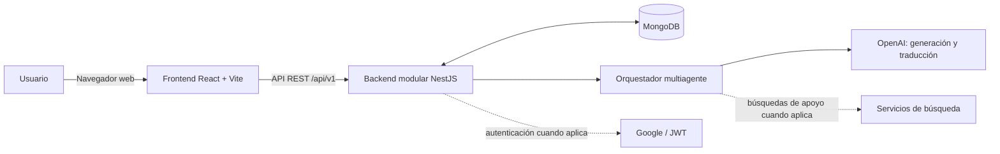
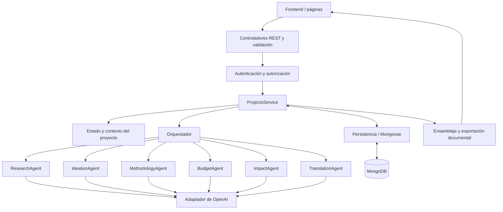
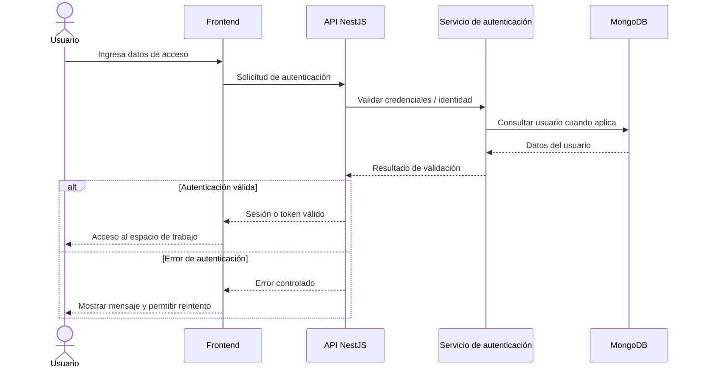
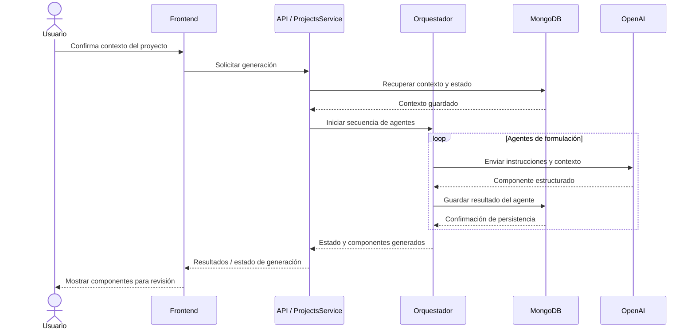
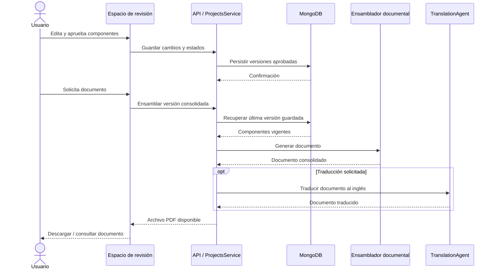
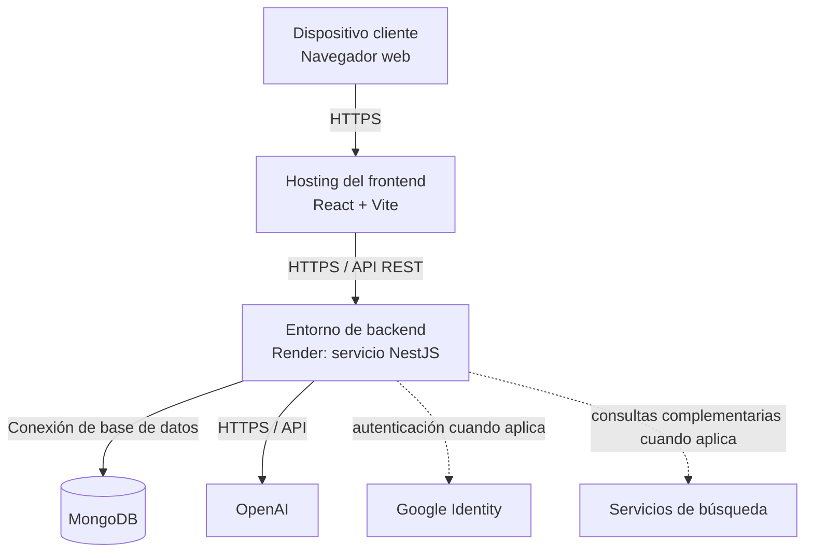

# Ágora — Informe del proyecto

Este informe presenta el estado de desarrollo de Ágora, la evolución del MVP, la evidencia de validación disponible y las decisiones técnicas adoptadas para avanzar hacia la entrega final.​
​
Por esta razón, cada componente deberá desarrollarse con un mínimo de tres párrafos, con el fin de asegurar el nivel de profundidad y coherencia esperado en un informe final.

## Resumen / Abstract

La formulación de proyectos de Ciencia, Tecnología e Innovación —CTeI— requiere transformar una idea inicial en una propuesta estructurada cuyos componentes mantengan coherencia entre el problema identificado, los antecedentes, los objetivos, las actividades, la metodología, el cronograma, el presupuesto, los beneficiarios, los riesgos y los impactos esperados. Para estudiantes universitarios con experiencia limitada en formulación, este proceso representa una dificultad debido a la necesidad de identificar qué información se requiere, organizarla técnicamente, mantener relaciones lógicas entre los diferentes apartados y superar la denominada barrera de la “hoja en blanco”.

Como respuesta a esta problemática se desarrolla Ágora, una aplicación web con características de Producto Mínimo Viable —MVP— que utiliza inteligencia artificial generativa y un sistema multiagente especializado para acompañar al usuario desde la definición inicial de su idea hasta la obtención de un documento estructurado de proyecto CTeI. La solución integra recopilación guiada de información, generación mediante inteligencia artificial, revisión humana, edición de componentes, persistencia del progreso, ensamblaje documental, traducción del español al inglés y exportación del resultado.

El alcance funcional inicialmente planteado evolucionó durante el proceso de desarrollo. En su estado actual, Ágora genera trece apartados: marco teórico, estado del arte, planteamiento del problema, antecedentes, bibliografía, actividades, objetivos SMART, cronograma, metodología, presupuesto, beneficiarios, riesgos e impactos esperados. El documento consolidado generado por la plataforma evidencia expresamente esta estructura de trece componentes.

El sistema emplea un orquestador encargado de coordinar los agentes especializados. La formulación se distribuye funcionalmente entre agentes orientados a investigación, ideación, metodología, presupuesto e impactos. Adicionalmente, se incorporó un agente traductor para transformar el documento consolidado del español al inglés. El flujo actual utiliza OpenAI desde un backend modular construido en NestJS y almacena usuarios, proyectos, contexto, estados, resultados generados y contenido editado en MongoDB.

Durante el desarrollo también se identificó la necesidad de obtener información adicional antes de generar la metodología y el presupuesto. Como consecuencia, se incorporó una etapa de preguntas de ejecución que permite recoger información relacionada con las condiciones reales del proyecto antes de continuar con dichos componentes. La interfaz evaluada contempla nueve preguntas asociadas con esta etapa, buscando mantener trazabilidad entre objetivos, actividades, metodología y presupuesto. Asimismo, se reestructuró el prompt correspondiente al agente de presupuesto para mejorar la relación entre actividades, necesidades, recursos y costos.

Actualmente, los agentes se encuentran funcionando y la fase principal del proyecto se concentra en pruebas funcionales, pruebas de usabilidad, corrección de incidencias y estabilización. Se han realizado ejercicios con usuarios y una evaluación comparativa entre el prototipo original desarrollado en Figma y la interfaz implementada. Esta evaluación favoreció a la versión implementada en seis de ocho criterios y obtuvo una valoración ponderada de 84,3 sobre 100 frente a 66,4 del prototipo; sin embargo, el propio estudio aclara que se trata de una evaluación experta comparativa y no de un experimento estadístico de producción.

Los resultados de las pruebas han producido modificaciones concretas en frontend y backend, entre ellas la reorganización del flujo de inicio de sesión, solución de problemas de lentitud durante el acceso, ajustes en el espacio entre botones, incorporación de mecanismos para regresar a pantallas anteriores y al inicio, persistencia del progreso cuando el usuario abandona temporalmente un proyecto, establecimiento de límites para las regeneraciones y delimitación de la cantidad de objetivos generados.

El estado actual permite afirmar que el núcleo funcional del MVP se encuentra implementado y que el proyecto se encuentra en una fase de validación y mejora continua. Las actividades pendientes se concentran principalmente en continuar las pruebas, documentar sistemáticamente los resultados, estabilizar el producto, medir el comportamiento bajo carga y ejecutar las mejoras arquitectónicas que resulten justificadas por evidencia empírica.

**Abstract**

The formulation of Science, Technology and Innovation —STI— projects requires transforming an initial idea into a structured proposal in which the problem, background, objectives, activities, methodology, schedule, budget, beneficiaries, risks and expected impacts remain logically connected. For university students with limited project-formulation experience, this process may be difficult because they need to identify the required information, organize it technically and overcome the initial “blank page” barrier.

To address this problem, Ágora has been developed as a web-based Minimum Viable Product supported by generative artificial intelligence and a specialized multi-agent system. The platform guides users from the initial description of an idea to the production of a structured STI project document through guided information collection, AI-based generation, human review, editing, persistence, document assembly, Spanish-to-English translation and document export.

The current system generates thirteen mandatory components: theoretical framework, state of the art, problem statement, background, bibliography, activities, SMART objectives, schedule, methodology, budget, beneficiaries, risks and expected impacts.

The application currently integrates a React/Vite frontend, a modular NestJS backend, MongoDB persistence and OpenAI-based generative services. Five specialized formulation agents are coordinated by an orchestrator and complemented by a translation agent. An additional information-collection step has also been introduced before methodology and budget generation in order to obtain more realistic execution data.

At the current stage, the core multi-agent flow is operational and the project is focused on functional validation, usability testing, interface improvements and system stabilization. User tests and comparative interface evaluations have already produced changes in both frontend and backend components.

The project therefore has evolved from an initial proof-of-concept design into a functional MVP currently undergoing iterative validation. Remaining work focuses on continued testing, performance measurement, documentation of evidence and architectural reinforcement for future pilot-scale operation.

## 1. Introducción

La formulación de proyectos de Ciencia, Tecnología e Innovación constituye una actividad fundamental en ambientes universitarios, investigativos y de emprendimiento, debido a que permite transformar necesidades, problemáticas, oportunidades e ideas preliminares en iniciativas estructuradas susceptibles de ser analizadas, evaluadas y posteriormente implementadas.

Formular un proyecto no consiste únicamente en escribir diferentes secciones. Requiere establecer relaciones lógicas entre cada una de ellas. El problema identificado debe justificar los objetivos; los objetivos deben traducirse en actividades verificables; las actividades deben organizarse dentro de una metodología y un cronograma; el presupuesto debe responder a los recursos realmente necesarios para ejecutar dichas actividades; y los impactos esperados deben guardar correspondencia con el alcance de la intervención. Para estudiantes con experiencia limitada, esta articulación representa una dificultad importante. Una persona puede reconocer claramente una problemática o contar con una idea potencialmente valiosa y, aun así, desconocer cómo estructurarla dentro de un proyecto formal.

Esta dificultad se relaciona con la denominada barrera de la hoja en blanco. En Ágora, esta expresión no se interpreta únicamente como una dificultad de redacción, sino como la ausencia de una estructura inicial que permita transformar información dispersa en una secuencia organizada de decisiones de formulación. Los avances recientes en inteligencia artificial generativa ofrecen nuevas posibilidades para atender esta situación. Los modelos de lenguaje pueden interpretar información, producir textos, organizar conceptos, transformar contenido y mantener contexto entre diferentes interacciones. No obstante, el uso directo de asistentes generales exige que el usuario conozca qué debe preguntar, qué estructura debe solicitar y cómo evaluar posteriormente la calidad de las respuestas.

Ágora parte de una aproximación diferente. En lugar de proporcionar únicamente un campo abierto para interactuar con un modelo de lenguaje, organiza el proceso mediante un flujo guiado de formulación. El usuario proporciona inicialmente información sobre su idea; el sistema identifica y organiza el contexto; posteriormente los agentes especializados generan diferentes componentes; el usuario revisa, modifica y aprueba los contenidos; finalmente, el sistema los integra dentro de un documento consolidado. Durante el desarrollo, este modelo se amplió hasta alcanzar trece apartados estructurales. El sistema actualmente genera marco teórico, estado del arte, planteamiento del problema, antecedentes, bibliografía, actividades, objetivos SMART, cronograma, metodología, presupuesto, beneficiarios, riesgos e impactos esperados. El documento de prueba generado por Ágora confirma la producción integral de dichos apartados.

Adicionalmente, el proyecto evolucionó desde una arquitectura frontend inicialmente simulada hacia una solución con backend real, persistencia, autenticación e integración con inteligencia artificial. La arquitectura actual está compuesta por un frontend React/Vite, un backend modular en NestJS, MongoDB como mecanismo de persistencia y OpenAI como proveedor de IA. El proyecto ya no se encuentra únicamente en una fase de diseño conceptual. El núcleo funcional está implementado y el esfuerzo actual se concentra en validar su comportamiento, mejorar la experiencia del usuario, corregir incidencias e identificar las condiciones técnicas necesarias para una futura operación piloto.

**1.1 Justificación** 
La pertinencia de Ágora puede analizarse desde dimensiones académicas, prácticas y tecnológicas.

Desde la perspectiva académica, disminuir la barrera inicial de formulación puede permitir que los estudiantes concentren una mayor parte de su esfuerzo en comprender, revisar y mejorar sus ideas. La herramienta no pretende eliminar el trabajo intelectual del estudiante, sino proporcionarle una estructura inicial susceptible de revisión.

La relevancia académica también radica en la posibilidad de hacer visibles las relaciones entre componentes. En lugar de generar de forma completamente independiente un problema, unos objetivos, una metodología y un presupuesto, Ágora busca mantener una cadena de información común que permita que los apartados posteriores utilicen decisiones previamente establecidas.

Esto es especialmente importante para metodología y presupuesto. Durante las pruebas se identificó que la generación de estos componentes requería información operativa adicional. Como consecuencia, se incorporó un espacio de preguntas antes de continuar con estos apartados, de manera que el usuario pueda proporcionar datos relacionados con las condiciones reales de ejecución.

Desde una perspectiva práctica, Ágora permite transformar una idea preliminar en un documento organizado sin obligar al usuario a conocer previamente la totalidad de los componentes o a diseñar por sí mismo todas las instrucciones necesarias para interactuar con una IA generalista.

La plataforma también proporciona continuidad. El usuario puede abandonar temporalmente un proyecto y conservar su progreso, regresar posteriormente, revisar los contenidos generados y continuar desde el punto correspondiente.

Desde la perspectiva tecnológica, Ágora constituye un caso aplicado para evaluar la integración de sistemas multiagente, modelos generativos, persistencia, revisión humana, traducción, generación documental y procesos de validación dentro de un mismo producto.

Su valor no depende de desarrollar un nuevo modelo de lenguaje, sino de diseñar una orquestación especializada que convierta tecnologías existentes en una experiencia específica para formulación de proyectos CTeI.

Por estas razones, el proyecto posee relevancia académica y aplicada: busca disminuir una barrera real del proceso inicial de formulación, mantener al usuario como responsable del contenido final y generar evidencia sobre la viabilidad y limitaciones de utilizar IA generativa como apoyo dentro de este contexto.

## 2. Marco conceptual

El desarrollo de Ágora requiere articular conceptos provenientes de la formulación de proyectos, la ingeniería de software y la inteligencia artificial. Estos fundamentos permiten comprender tanto el problema abordado como las decisiones adoptadas durante el diseño de la solución.

**Ciencia, Tecnología e Innovación —CTeI—**

Los proyectos de Ciencia, Tecnología e Innovación —CTeI— comprenden un conjunto coherente e integral de actividades orientadas a alcanzar un fin mediante objetivos específicos, una metodología definida y recursos humanos, tecnológicos y financieros estimados. Esta definición oficial de Minciencias permite fundamentar la estructura de Ágora y su orientación hacia la organización articulada de los componentes de una propuesta [1].

Ágora no pretende implementar una metodología institucional completa de formulación CTeI. Su alcance corresponde a la construcción de un borrador inicial que permita organizar los elementos fundamentales de una propuesta antes de una revisión especializada.

**Inteligencia artificial generativa**

La inteligencia artificial generativa comprende sistemas capaces de producir contenido nuevo a partir de patrones aprendidos durante su entrenamiento y del contexto proporcionado durante una interacción. En Ágora, esta tecnología se utiliza para interpretar información textual, formular preguntas de aclaración, estructurar contenido y generar borradores. Debido a que los sistemas generativos pueden producir información incorrecta o contenido no sustentado, su utilización debe acompañarse de mecanismos de evaluación y revisión [2][3].

Su utilización implica limitaciones relacionadas con precisión, reproducibilidad y posibilidad de producir información incorrecta o no sustentada. NIST identifica, entre otros riesgos, la generación de contenido falso o erróneo presentado con apariencia de confianza y la posibilidad de generar citas o justificaciones que no respaldan realmente una afirmación [2]. Por esta razón, Ágora adopta un esquema de revisión humana antes de considerar aprobado un componente.

**Modelos de lenguaje de gran tamaño —LLM—**

Los Large Language Models son modelos capaces de procesar y generar lenguaje natural. Dentro de Ágora se utilizará al menos un LLM accesible mediante servicios de integración para apoyar las tareas de diagnóstico y generación.

El modelo no tendrá autonomía absoluta sobre el contenido. Sus respuestas estarán condicionadas por instrucciones estructuradas, información suministrada por el usuario, plantillas asociadas a cada componente y reglas definidas desde la aplicación.

**Sistemas multiagente**

Un sistema multiagente distribuye una tarea compleja entre diferentes componentes especializados. En Ágora, el concepto de agente será utilizado desde una perspectiva funcional: cada agente contará con responsabilidades, entradas y salidas delimitadas y será coordinado mediante un mecanismo de orquestación.

Para el MVP se contemplan cuatro responsabilidades principales:

contexto y diagnóstico;
formulación;
ensamblaje y verificación;
traducción, en caso de alcanzar esta funcionalidad complementaria.

El hecho de denominar estos módulos “agentes” no significa que deban operar como entidades completamente autónomas. La arquitectura busca principalmente separar responsabilidades y facilitar el control del flujo.

**Orquestación**

La orquestación corresponde al mecanismo encargado de determinar qué componente debe intervenir en cada etapa y qué información será transmitida entre ellos. Su función es mantener un recorrido controlado y evitar que cada agente funcione de manera aislada.

El orquestador deberá garantizar que la generación solamente ocurra cuando exista información mínima suficiente y que el ensamblaje utilice las versiones más recientes guardadas por el usuario.

**Human-in-the-loop**

El enfoque human-in-the-loop mantiene a una persona dentro del proceso de decisión y validación de los resultados producidos mediante inteligencia artificial. NIST señala que las responsabilidades humanas y los mecanismos de supervisión deben definirse de acuerdo con el contexto de uso del sistema [4].

En Ágora, este principio se materializa en la posibilidad de visualizar, editar, guardar y aprobar individualmente cada componente. Por consiguiente, la salida generada por inteligencia artificial será tratada como una propuesta inicial y no como contenido definitivo.

**Producto Mínimo Viable —MVP—**

Para este proyecto, el MVP se entiende como la versión mínima funcional que permite demostrar el valor central de Ágora y ejecutar completamente el recorrido propuesto.

Por tanto, una funcionalidad pertenece al MVP obligatorio cuando su ausencia impide demostrar el flujo comprendido entre el ingreso de una idea y la obtención de un documento revisado y exportable.

No se consideran parte del MVP aquellas funcionalidades que mejoren la experiencia pero cuya ausencia no impida demostrar ese recorrido, como paneles administrativos, colaboración en tiempo real, historial avanzado de versiones o selección entre múltiples proveedores de inteligencia artificial.

**Arquitectura monolítica modular**

Una arquitectura monolítica modular concentra la aplicación dentro de una misma unidad de despliegue, pero organiza internamente las responsabilidades mediante módulos desacoplados. En el contexto de Ágora, esta decisión busca mantener una estructura controlable durante la etapa de MVP y evitar introducir prematuramente la complejidad operativa de múltiples servicios. La literatura técnica sobre arquitectura evolutiva advierte que los microservicios introducen costos de operación y que las fronteras entre servicios deben estar suficientemente comprendidas antes de separar un sistema [5].

Esta arquitectura resulta apropiada para el alcance académico del proyecto porque reduce la complejidad operativa frente a un esquema de microservicios, conservando al mismo tiempo separación entre interfaz, servicios, persistencia, integración con IA y ensamblaje documental.

**Completitud y coherencia**

La completitud corresponde a la existencia de la información y de los componentes mínimos requeridos.

La coherencia, para efectos del MVP, se entenderá como la existencia de relaciones lógicas básicas entre determinados componentes. Entre ellas se evaluarán principalmente:

correspondencia entre problema y objetivo general;
relación entre objetivo general y objetivos específicos;
presencia de población beneficiaria;
existencia de actividades o fases metodológicas;
relación general entre solución e impactos;
ausencia de componentes vacíos.

Estas comprobaciones tendrán un alcance básico y no equivaldrán a una evaluación de calidad científica.

**Usabilidad**

La usabilidad representa el grado en que una persona puede comprender y completar el flujo propuesto con un nivel razonable de facilidad.

La validación del MVP considerará especialmente la claridad de las preguntas, la navegación entre componentes, la edición del contenido y la capacidad de completar el recorrido sin asistencia directa del equipo desarrollador.

## 3. Planteamiento del problema

### 3.1 Descripción del problema

Los estudiantes universitarios interesados en formular proyectos de Ciencia, Tecnología e Innovación pueden identificar problemas, necesidades u oportunidades y, sin embargo, enfrentar dificultades para convertir dichas ideas en propuestas estructuradas.

La formulación requiere determinar qué información debe recopilarse, cómo debe organizarse y qué relaciones deben conservarse entre los diferentes componentes.

La dificultad se incrementa porque algunos apartados dependen de información previamente definida. Los objetivos deben responder al problema; las actividades deben materializar los objetivos; el cronograma debe organizar temporalmente las actividades; la metodología debe describir cómo serán ejecutadas; y el presupuesto debe representar los recursos realmente necesarios para su desarrollo.

Entre las principales causas del problema se identifican:

experiencia limitada en formulación;
desconocimiento de la estructura de proyectos;
dificultad para identificar información faltante;
problemas para relacionar los diferentes componentes;
necesidad de orientación metodológica;
barrera inicial de la hoja en blanco;
dependencia de conocimientos previos para utilizar adecuadamente asistentes de IA de propósito general.

La consecuencia puede ser la construcción de propuestas incompletas, componentes poco relacionados entre sí, tiempos elevados para obtener una primera versión o abandono temprano de ideas que podrían ser sometidas a revisión académica.

El problema central se define como:

**Los estudiantes universitarios presentan dificultades para transformar ideas iniciales en propuestas estructuradas y coherentes de proyectos de Ciencia, Tecnología e Innovación, debido a la limitada experiencia en formulación, la dificultad para identificar y relacionar la información necesaria y la ausencia de un mecanismo guiado que acompañe progresivamente la construcción de sus componentes.**

El problema no se plantea como ausencia de inteligencia artificial disponible. Existen herramientas generativas de propósito general. La brecha identificada corresponde a la necesidad de transformar dichas capacidades en un proceso especializado de formulación.

### 3.2 Restricciones y supuestos de diseño

El desarrollo y funcionamiento del MVP considera las siguientes restricciones y supuestos:

| Categoría | Restricción o supuesto | Implicación |
|---|---|---|
| Tiempo | El proyecto se desarrolla dentro de un periodo académico limitado. | Las funcionalidades críticas tienen prioridad sobre las mejoras secundarias. |
| Equipo | El desarrollo es realizado por un equipo reducido. | Se evita introducir complejidad distribuida innecesaria. |
| Inteligencia artificial | El sistema depende de un proveedor externo de modelos generativos. | Los fallos, las cuotas o la latencia de OpenAI pueden afectar la generación o traducción. |
| Costos | El uso del modelo genera costos relacionados con solicitudes y tokens. | Deben controlarse las regeneraciones y el consumo innecesario. |
| Calidad de salida | Una salida generada puede contener errores, inferencias o información no verificada. | Se mantiene la revisión humana y el resultado se presenta como borrador. |
| Disponibilidad del proveedor | El sistema no controla la disponibilidad total de OpenAI. | Deben implementarse mecanismos de manejo de errores y, progresivamente, reintentos y desacoplamiento. |
| Reproducibilidad | Una misma entrada puede generar variaciones. | Las pruebas deben evaluar la estructura y coherencia, no la igualdad textual exacta. |
| Contexto | La calidad depende de la información proporcionada por el usuario. | Se incorporan preguntas complementarias cuando hacen falta datos. |
| Metodología y presupuesto | No deben generarse únicamente a partir de supuestos del modelo. | Se incorporó una fase previa de preguntas sobre la ejecución. |
| Usuarios | La validación actual se realiza con grupos reducidos. | Los resultados aún no representan una validación estadísticamente generalizable. |
| Arquitectura | La aplicación actual ejecuta la generación multiagente dentro del ciclo asociado al backend. | Puede producir problemas de saturación o tiempo de espera cuando aumente la concurrencia. |
| Conectividad | La aplicación requiere conexión a internet. | No se contempla la operación sin conexión. |
| Validación académica | Ágora no certifica que el proyecto sea viable o esté científicamente aprobado. | La revisión especializada continúa siendo necesaria. |
| Bibliografía | La generación de referencias requiere verificación humana. | El usuario debe comprobar la existencia, pertinencia y exactitud de las fuentes. |
| Escalabilidad | El sistema se encuentra en etapa de MVP o piloto. | La alta disponibilidad masiva aún no constituye una capacidad demostrada. |
| Usuarios de prueba | Su disponibilidad puede afectar el número y ritmo de las pruebas. | La evaluación continuará durante la etapa de estabilización. |

### 3.3 Alcance actualizado

El alcance inicial fue modificado conforme avanzó el desarrollo.

La versión actual de Ágora comprende un MVP funcional en fase de validación y estabilización.

**Componentes obligatorios del MVP**

El sistema genera los siguientes trece apartados:

- Marco teórico.
- Estado del arte.
- Planteamiento del problema.
- Antecedentes.
- Bibliografía.
- Actividades.
- Objetivos SMART.
- Cronograma.
- Metodología.
- Presupuesto.
- Beneficiarios.
- Riesgos.
- Impactos esperados.

La generación de estos trece apartados ya se evidencia en los documentos consolidados producidos por Ágora. El cronograma, por ejemplo, incluye objetivos, actividades, inicio, fin, duración, dependencias y entregables, demostrando que algunos componentes comprenden información estructurada adicional al texto narrativo.

El presupuesto constituye igualmente un componente independiente y se construye vinculando objetivos, actividades, rubros, descripciones, costos unitarios, cantidades y totales.

Funcionalidades obligatorias

El MVP deberá mantener como compromisos funcionales:

- Creación e inicio de un proyecto.
- Autenticación del usuario.
- Almacenamiento y recuperación del proyecto.
- Recopilación de información inicial.
- Generación de los trece apartados.
- Etapa complementaria de preguntas para la metodología y el presupuesto.
- Edición de componentes.
- Guardado de modificaciones.
- Aprobación de contenido.
- Control de regeneraciones.
- Persistencia del progreso.
- Ensamblaje documental.
- Traducción del español al inglés.
- Exportación del documento.
- Manejo de errores.
- Pruebas funcionales.
- Pruebas con usuarios.

**Formato de salida comprometido**

Con la evidencia actualmente disponible, el formato de exportación que puede declararse de forma verificable como compromiso del MVP es PDF, dado que el documento consolidado suministrado fue generado por Ágora en dicho formato.

Por rigor académico, DOCX no se declara en este informe como compromiso obligatorio mientras no se incorpore evidencia de su implementación efectiva.

**Traducción**

La traducción del documento consolidado del español al inglés forma actualmente parte del funcionamiento de la solución y se encuentra asociada con un agente traductor independiente.

**Exclusiones**

El proyecto no tiene como propósito:

- Sustituir a un formulador profesional.
- Certificar la viabilidad técnica, jurídica, financiera o científica.
- Garantizar la aprobación en convocatorias.
- Sustituir la revisión bibliográfica especializada.
- Eliminar completamente los errores o las alucinaciones de los modelos generativos.
- Operar actualmente como una plataforma institucional de alta disponibilidad.
- Soportar cargas masivas sin validación previa.
- Generar decisiones académicas definitivas sin revisión humana.

## 4. Objetivos

### 4.1 Objetivo general

Desarrollar, durante un periodo de cuatro meses, una prueba de concepto funcional con características de producto mínimo viable de un sistema multiagente basado en inteligencia artificial generativa, que permita recopilar y organizar la información básica de una idea de proyecto de Ciencia, Tecnología e Innovación —CTeI—, identificar datos faltantes, generar trece componentes estructurales, facilitar su revisión y edición por parte del usuario, y consolidarlos en un documento preliminar integrado y exportable.

### 4.2 Objetivos específicos

OB1 : Diseñar durante los dos primeros meses del proyecto, un mecanismo de interacción guiada que permita recopilar la información básica de una idea de proyecto CTeI, verificar la existencia de los datos mínimos requeridos e identificar vacíos para formular preguntas de aclaración al usuario.

OB2: Integrar entre el segundo y el tercer mes, un motor basado en inteligencia artificial generativa que procese la información consolidada y produzca de manera estructurada los trece componentes definidos para el borrador del proyecto CTeI, incorporando verificaciones básicas de completitud y coherencia.

OB3: Implementar durante el tercer mes, una interfaz que permita al usuario visualizar, modificar, guardar y aprobar individualmente los trece componentes generados, e integrar la última versión guardada de cada sección en un documento preliminar unificado y exportable.

OB4: Integrar y validar, durante el cuarto mes, el funcionamiento de la prueba de concepto mediante la ejecución de pruebas funcionales del recorrido completo y ejercicios de uso con un grupo reducido de usuarios, evaluando la usabilidad, la coherencia general del contenido, el tiempo de generación y la utilidad percibida del sistema.

## 5. Estado del arte / soluciones relacionadas

El estado del arte relacionado con Ágora puede organizarse en tres grupos: asistentes generativos de propósito general, herramientas especializadas en investigación académica y sistemas multiagente basados en modelos de lenguaje. La comparación se realiza a partir de los criterios que resultan relevantes para el problema planteado: captura guiada, coherencia entre componentes, control humano, persistencia, trazabilidad, bibliografía y exportación.

### 5.1 Asistentes generativos de propósito general

Herramientas como ChatGPT permiten generar, reorganizar, resumir, explicar y transformar contenido mediante interacción conversacional [6]. Gemini pertenece igualmente a la categoría de asistentes generativos de propósito general. Estas herramientas ofrecen flexibilidad y reducen la barrera técnica para acceder a modelos de lenguaje, pero su flujo no está diseñado específicamente para recorrer de manera controlada los trece componentes de un proyecto CTeI.

El principal reto para el usuario consiste en convertir una herramienta de propósito general en un proceso de formulación: debe conocer qué información suministrar, qué preguntas realizar, qué estructura solicitar y cómo comprobar que los resultados de diferentes interacciones mantienen coherencia entre sí. Ágora aborda esta brecha mediante un flujo previamente definido, agentes especializados y persistencia de los resultados.

### 5.2 Herramientas especializadas en investigación

Elicit está orientado a tareas de investigación y síntesis de literatura. Su flujo incluye búsqueda, selección, extracción de información y síntesis, y ofrece mecanismos de trazabilidad de las afirmaciones hacia las fuentes utilizadas [7]. Estas capacidades son relevantes para el componente bibliográfico y para la fundamentación de un proyecto.

Sin embargo, el objetivo de Elicit es distinto al de Ágora. Su flujo se concentra en la evidencia científica y la revisión de literatura, mientras que Ágora busca recorrer de extremo a extremo la construcción de un borrador de proyecto CTeI, incluyendo problema, antecedentes, objetivos, actividades, cronograma, metodología, presupuesto, beneficiarios, riesgos e impactos.

### 5.3 Sistemas multiagente basados en LLM

La investigación reciente sobre sistemas multiagente basados en modelos de lenguaje analiza cómo diferentes agentes pueden asumir roles especializados, coordinarse y participar en la resolución de tareas complejas [8]. Esta línea de trabajo respalda la decisión de separar responsabilidades en Ágora en lugar de solicitar a un único agente la generación completa del documento.

En Ágora, la especialización es funcional y controlada. ResearchAgent trabaja sobre fundamentación e investigación; IdeationAgent sobre actividades, objetivos y cronograma; MethodologyAgent sobre la metodología; BudgetAgent sobre recursos y costos; ImpactAgent sobre beneficiarios, riesgos e impactos; y TranslationAgent sobre la traducción del documento consolidado.

### 5.4 Comparación de soluciones

| Criterio | Asistentes generativos generales | Elicit | Sistemas multiagente | Ágora |
|---|---|---|---|---|
| Captura guiada para formulación CTeI | No específica | Orientada a investigación | Depende de la implementación | Sí |
| Coherencia entre componentes CTeI | Depende del usuario | Centrada en evidencia | Depende de la orquestación | Se controla mediante contexto compartido y secuencia |
| Revisión humana | Disponible | Integrada en distintos pasos | Depende de la implementación | Sí, antes de aprobar componentes |
| Persistencia del proyecto | Depende del producto | Sí, orientada a investigación | Depende de la implementación | Sí |
| Trazabilidad de prompts/versiones | No es el objetivo principal | Orientada al proceso de investigación | Depende de la implementación | Se plantea como necesidad de evolución |
| Bibliografía | Puede generar referencias, pero requiere verificación | Funcionalidad central | Depende de la implementación | Se genera como componente y requiere verificación humana |
| Exportación de proyecto CTeI | No específica | Orientada a informes de investigación | Depende de la implementación | PDF |
| Flujo de trece componentes CTeI | No | No | No necesariamente | Sí |
| Preguntas adicionales para metodología y presupuesto | No específicas | No | Depende de la implementación | Sí |

La comparación muestra que la diferenciación de Ágora no consiste en afirmar que genera contenido que otras herramientas no pueden generar. La diferencia está en organizar esas capacidades dentro de un flujo especializado, persistente y revisable.

### 5.5 Justificación de la propuesta de Ágora

A partir de esta comparación, la elección de trece componentes responde al alcance funcional definido durante el desarrollo y no a la intención de maximizar el número de agentes. La separación permite mantener responsabilidades delimitadas y reutilizar información previa.

Las preguntas adicionales antes de metodología y presupuesto surgieron de las pruebas realizadas: el contexto inicial no siempre contenía información suficiente para representar las condiciones reales de ejecución. La orquestación controlada permite incorporar esta información antes de ejecutar los agentes correspondientes.

Por tanto, Ágora se diferencia principalmente por la combinación de captura guiada, generación especializada, persistencia, revisión humana, preguntas complementarias, ensamblaje y exportación dentro de un mismo recorrido.

## 6. Solución propuesta

Ágora es una aplicación web orientada a apoyar la formulación de proyectos CTeI mediante una arquitectura multiagente y modelos de inteligencia artificial generativa.

La solución está dirigida inicialmente a estudiantes universitarios y otros usuarios que cuenten con una idea de proyecto, pero requieran acompañamiento para transformarla en una estructura formal.

El recorrido comienza con la creación del proyecto y la recopilación de contexto. La información posteriormente es procesada por un orquestador que coordina agentes especializados. Los agentes de formulación trabajan de forma secuencial y distribuyen la generación de los trece componentes. 

- El ResearchAgent se concentra en componentes relacionados con fundamentación e investigación.
- El IdeationAgent estructura actividades, objetivos SMART y cronograma.
- El MethodologyAgent utiliza las decisiones previas y las respuestas adicionales del usuario para producir una metodología relacionada con la ejecución real.
- El BudgetAgent procesa actividades, recursos y demás condiciones para producir el presupuesto. Su prompt fue modificado durante las pruebas con el propósito de mejorar su alineación con el proyecto.
- El ImpactAgent trabaja sobre beneficiarios, riesgos e impactos esperados.
- Finalmente, el TranslationAgent permite producir la versión traducida del documento.

La solución actual utiliza un frontend construido en React/Vite y un backend modular desarrollado con NestJS. MongoDB almacena la información y OpenAI proporciona las capacidades generativas.

El sistema conserva los resultados generados por cada agente y permite reanudar procesos previamente iniciados. La persistencia incremental reduce la pérdida completa del trabajo en caso de una interrupción.

**Flujo funcional actual**

El flujo puede resumirse de la siguiente manera:

Inicio/autenticación → creación del proyecto → recopilación de contexto → generación inicial → objetivos y actividades → preguntas complementarias de ejecución → metodología → presupuesto → componentes restantes → revisión → edición/aprobación → ensamblaje → traducción → exportación PDF.

**Participación humana**

La interfaz permite que el usuario revise el contenido producido antes de incorporarlo definitivamente al documento.
Las modificaciones introducidas por la persona constituyen parte del flujo funcional y no una actividad externa.
La plataforma mantiene de esta forma un enfoque human-in-the-loop.

**Persistencia y continuidad**

Uno de los hallazgos importantes durante las pruebas fue la necesidad de permitir que un usuario saliera del proceso sin perder el avance.
Esta funcionalidad ya fue incorporada: al abandonar temporalmente un proyecto, el progreso se conserva y el usuario puede continuar posteriormente.

**Control de regeneraciones**

Las pruebas también llevaron a establecer limitaciones sobre el número o condiciones de regeneración.
El objetivo es evitar ciclos indefinidos, controlar consumo del modelo y mejorar la previsibilidad del sistema.

**Delimitación de objetivos**

Se establecieron controles sobre la cantidad de objetivos dentro de un proyecto con el propósito de mantener el alcance manejable y evitar que la generación produzca estructuras excesivamente amplias.

**Traducción**

La formulación principal se mantiene en español y la traducción ocurre posteriormente sobre el documento consolidado, evitando duplicar el flujo completo de formulación en cada idioma.

Esta decisión también fue valorada positivamente en la evaluación comparativa de interfaz.

## 7. Metodología de desarrollo

El desarrollo de Ágora ha seguido un enfoque **iterativo e incremental**, caracterizado por ciclos sucesivos de diseño, implementación, prueba, identificación de problemas, ajuste y nueva validación.

A diferencia del planteamiento inicial, en el estado actual la metodología puede describirse principalmente en pasado y presente, debido a que una parte significativa de la implementación ya fue ejecutada.

### 7.1 Enfoque metodológico

La primera etapa se concentró en definir la experiencia del usuario y construir el frontend.

Se utilizaron React, Vite y TypeScript para desarrollar las interfaces, rutas, formularios, estados y mecanismos de interacción.

Durante las primeras fases se utilizaron servicios simulados para validar el recorrido sin depender todavía del backend definitivo.

Esta decisión permitió comprobar la navegación, la estructura de las pantallas, el comportamiento de los componentes y la distribución de la información.

Posteriormente, se avanzó hacia una arquitectura real compuesta por frontend, backend modular, MongoDB e integración con OpenAI.

El backend actual utiliza NestJS y concentra los servicios relacionados con autenticación, usuarios, proyectos, integración con IA y *health checks*.

La lógica generativa se desarrolló de manera especializada y se organizó dentro del flujo multiagente.

Con el funcionamiento de los agentes, la metodología pasó de una etapa centrada en la implementación a una etapa orientada principalmente a la **estabilización y validación**.

### 7.2 Evolución del sistema multiagente

El proceso se organizó inicialmente alrededor de responsabilidades diferenciadas.

Posteriormente, se integraron los agentes reales con el proveedor de inteligencia artificial.

Actualmente funcionan los agentes asociados con:

- Investigación.
- Ideación.
- Metodología.
- Presupuesto.
- Impactos.
- Traducción.

El orquestador ejecuta los agentes de formulación en una secuencia previamente determinada. El análisis arquitectónico actual documenta que *Research*, *Ideation*, *Methodology*, *Budget* e *Impact* forman el recorrido principal.

### 7.3 Ajuste del flujo de metodología y presupuesto

Uno de los cambios metodológicos más relevantes ocurrió durante la integración de los agentes de metodología y presupuesto.

Las pruebas mostraron que utilizar únicamente el contexto general y los componentes previamente generados podía resultar insuficiente para representar las condiciones reales de ejecución.

Por esta razón, se incorporó un nuevo espacio de preguntas.

Actualmente, después de obtener información asociada con los objetivos y las actividades, y antes de continuar con la metodología y el presupuesto, el usuario responde información adicional relacionada con la ejecución.

La evaluación de la interfaz identifica nueve preguntas obligatorias dentro de esta etapa.

Este cambio busca proporcionar al sistema mayor información sobre recursos, condiciones, necesidades y características reales.

La incorporación de estas preguntas también condujo a una **reestructuración del prompt del agente de presupuesto**.

La mejora buscó aumentar la consistencia entre:

**Objetivos → actividades → metodología → recursos → costos.**

### 7.4 Construcción y validación de los trece componentes

El flujo actual produce trece componentes.

La existencia de estos componentes ya puede comprobarse mediante documentos generados por Ágora.

Por ejemplo, el documento utilizado como evidencia contiene un apartado de metodología compuesto por una ruta de ejecución articulada en fases.

También incorpora un presupuesto relacionado con los medios necesarios para ejecutar las actividades propuestas, incluyendo talento humano, infraestructura, equipos, logística, materiales, servicios y otros conceptos.

Los apartados finales incluyen beneficiarios, riesgos e impactos esperados como componentes independientes.

### 7.5 Estrategia de pruebas de usabilidad y funcionamiento

En la etapa actual se realizan pruebas de forma continua.

La validación contempla tanto aspectos técnicos como de experiencia de usuario.

Se han ejecutado pruebas con usuarios para identificar dificultades durante la navegación, creación, reanudación, generación y revisión de proyectos.

Como resultado de estas pruebas, se implementaron modificaciones tanto en el frontend como en el backend:

- Reorganización del flujo y del orden del inicio de sesión.
- Solución de la lentitud identificada durante el inicio de sesión.
- Ajuste del espacio entre botones.
- Incorporación de botones para regresar.
- Incorporación de un botón para volver al inicio durante el desarrollo del proyecto.
- Persistencia del progreso cuando el usuario sale temporalmente.
- Limitaciones sobre las regeneraciones.
- Delimitación del número de objetivos.
- Modificaciones asociadas con la navegación y la experiencia general.

Estas acciones representan la aplicación directa del enfoque iterativo: las decisiones no se mantienen únicamente por haber sido definidas durante el diseño inicial, sino que pueden modificarse cuando las pruebas muestran una alternativa más adecuada.

### 7.6 Evaluación comparativa de interfaces

Como parte del proceso, se realizó una evaluación comparativa entre:

- **Variante A:** prototipo inicial de Figma.
- **Variante B:** interfaz implementada.

Se analizaron actividades relacionadas con iniciar un proyecto, responder información, mantener la orientación, editar y aprobar componentes, retomar el trabajo y resolver dudas.

La variante implementada obtuvo una valoración ponderada de **84,3/100**, mientras que el prototipo alcanzó **66,4/100**. La interfaz implementada obtuvo resultados especialmente altos en revisión y edición, persistencia y control, ayuda, accesibilidad y ajuste al alcance.

No obstante, el análisis encontró que el prototipo original conservaba ventajas en la orientación durante el diagnóstico y en la reducción de la carga cognitiva mientras se respondían preguntas.

Este hallazgo llevó a conservar la interfaz implementada como base y continuar optimizando específicamente el proceso previo a la metodología y el presupuesto.

Debe señalarse que esta comparación corresponde a una **evaluación experta de dos interfaces**. El propio documento indica que no constituye un experimento estadístico con usuarios y que los puntajes sirven fundamentalmente para priorizar decisiones de diseño.

Las pruebas realizadas directamente con usuarios constituyen una línea de validación complementaria.

### 7.7 Estado actual de la metodología

El proyecto se encuentra actualmente dentro del siguiente ciclo:

**Prueba → observación → corrección → nueva prueba.**

La generación multiagente ya se encuentra operativa, por lo que el propósito principal de las iteraciones actuales no es demostrar si los agentes pueden generar componentes, sino mejorar la estabilidad, la facilidad de uso, la coherencia del flujo y el comportamiento integral del sistema.

Las pruebas continuarán hasta la entrega final.

## 8. Requerimientos

### 8.1 Funcionales

| ID | Requerimiento | Estado o criterio verificable |
|---|---|---|
| RF-01 | El sistema debe permitir la autenticación del usuario. | El usuario puede acceder mediante el flujo implementado. |
| RF-02 | El usuario debe poder crear un proyecto. | El proyecto queda registrado y asociado al usuario. |
| RF-03 | El sistema debe recopilar la información inicial del proyecto. | El contexto queda disponible para la formulación. |
| RF-04 | El sistema debe conservar el progreso. | El usuario puede salir y posteriormente retomar el proyecto. |
| RF-05 | El sistema debe ejecutar el flujo multiagente. | Los agentes procesan secuencialmente la información. |
| RF-06 | El sistema debe generar el marco teórico. | El apartado aparece en el documento. |
| RF-07 | El sistema debe generar el estado del arte. | El apartado aparece en el documento. |
| RF-08 | El sistema debe generar el planteamiento del problema. | El apartado aparece en el documento. |
| RF-09 | El sistema debe generar los antecedentes. | El apartado aparece en el documento. |
| RF-10 | El sistema debe generar la bibliografía. | El apartado aparece en el documento. |
| RF-11 | El sistema debe generar las actividades. | Las actividades se presentan de forma estructurada. |
| RF-12 | El sistema debe generar objetivos SMART. | Los objetivos aparecen diferenciados. |
| RF-13 | El sistema debe generar un cronograma. | El cronograma relaciona actividades, periodos y dependencias. |
| RF-14 | El sistema debe solicitar información adicional antes de generar la metodología y el presupuesto. | El usuario responde el bloque de preguntas correspondiente. |
| RF-15 | El sistema debe generar la metodología. | El apartado utiliza la información previa y complementaria. |
| RF-16 | El sistema debe generar el presupuesto. | El presupuesto se relaciona con las actividades y los recursos. |
| RF-17 | El sistema debe generar la identificación de beneficiarios. | El apartado aparece en el documento. |
| RF-18 | El sistema debe generar la identificación de riesgos. | Se identifican los riesgos y sus tratamientos. |
| RF-19 | El sistema debe generar los impactos esperados. | El apartado aparece en el documento. |
| RF-20 | El usuario debe poder revisar los componentes. | El espacio de trabajo permite consultar los trece apartados. |
| RF-21 | El usuario debe poder modificar el contenido. | Las modificaciones pueden guardarse. |
| RF-22 | El usuario debe poder aprobar los componentes. | Se conserva el estado correspondiente. |
| RF-23 | El sistema debe controlar las regeneraciones. | Se aplican las limitaciones definidas. |
| RF-24 | El sistema debe ensamblar los componentes. | Se genera un documento consolidado. |
| RF-25 | El sistema debe traducir el documento del español al inglés. | El `TranslationAgent` ejecuta la operación. |
| RF-26 | El sistema debe exportar el documento en formato PDF. | Se obtiene un archivo PDF válido. |
| RF-27 | El sistema debe manejar los fallos de las operaciones externas. | Se presentan estados o mensajes de error. |
| RF-28 | El sistema debe permitir regresar dentro del recorrido. | Existen controles de navegación hacia atrás. |
| RF-29 | El sistema debe permitir volver al inicio durante el desarrollo de un proyecto. | Existe una acción específica para regresar al inicio. |

### 8.2 No funcionales

### Usabilidad

**RNF-01.** El usuario deberá poder comprender el recorrido sin capacitación especializada.

**RNF-02.** Las acciones principales deberán mantenerse visualmente identificables.

**RNF-03.** Las pantallas deberán evitar una densidad innecesaria de información cuando esta aumente la carga cognitiva.

**RNF-04.** El sistema deberá mostrar el progreso y el estado del proyecto.

### Rendimiento

**RNF-05.** En la evolución arquitectónica, las operaciones interactivas deberán permanecer conceptualmente separadas de los procesos generativos de larga duración.

**RNF-06.** Las pruebas de rendimiento deberán considerar los percentiles p50, p95 y p99, y no limitarse a los valores promedio.

### Persistencia

**RNF-07.** El progreso de los proyectos no deberá perderse al cerrar voluntariamente la sesión o navegar fuera del proyecto.

**RNF-08.** Los resultados generados deberán conservarse para permitir la reanudación del proyecto.

### Seguridad

**RNF-09.** Las credenciales del proveedor de inteligencia artificial deberán permanecer en el backend.

**RNF-10.** Los proyectos deberán asociarse con sus respectivos usuarios propietarios.

**RNF-11.** La información personal no deberá utilizarse innecesariamente en métricas o telemetría.

### Confiabilidad

**RNF-12.** Un fallo parcial en la generación no deberá eliminar los resultados previamente almacenados.

**RNF-13.** Las operaciones que puedan reintentarse deberán diseñarse para evitar la duplicación de contenido o cobros.

### Mantenibilidad

**RNF-14.** La aplicación deberá mantener la separación entre las responsabilidades de autenticación, proyectos, inteligencia artificial, persistencia y generación documental.

**RNF-15.** El proveedor de inteligencia artificial deberá permanecer encapsulado para facilitar una posible sustitución.

### Accesibilidad

**RNF-16.** La interfaz deberá continuar con las validaciones de accesibilidad incorporadas durante las pruebas.

### Costos

**RNF-17.** Las regeneraciones deberán limitarse para evitar el consumo innecesario de recursos.

**RNF-18.** Las futuras pruebas de carga deberán registrar los tokens utilizados y el costo por trabajo (`job`) cuando sea técnicamente viable.

## 9. Evaluación de alternativas

Para definir la evolución técnica de Ágora se analizaron diferentes alternativas arquitectónicas considerando el comportamiento esperado del sistema, el nivel de acoplamiento, la facilidad de operación y la complejidad que cada opción introduciría. La comparación se entiende como una evaluación de diseño y no como una medición de producción.

### 9.1 Alternativas consideradas

**Alternativa A. Mantener la arquitectura actual**

React → NestJS → MongoDB → OpenAI.

Esta alternativa conserva la estructura actualmente implementada. Su principal ventaja es que permite continuar desarrollando y validando el producto sin introducir cambios arquitectónicos de gran impacto durante la etapa actual del proyecto. Su principal limitación se relaciona con las operaciones generativas de mayor duración, que actualmente se ejecutan dentro del flujo iniciado por el usuario.

**Alternativa B. Fortalecer el monolito modular actual**

Esta alternativa mantiene la arquitectura general, pero mejora progresivamente la separación de responsabilidades, el control de estados, la gestión de errores, las validaciones y la observabilidad.

Su ventaja es que permite aprovechar la base funcional existente y realizar mejoras incrementales sin sustituir el sistema. Para el alcance actual, representa una evolución razonable porque conserva la simplicidad del MVP mientras permite reforzar los puntos identificados durante las pruebas.

**Alternativa C. Separación de servicios**

Consiste en dividir algunas responsabilidades del sistema en componentes independientes. Aunque puede facilitar una evolución posterior, también incrementa la complejidad de despliegue, comunicación y monitoreo.

Para la etapa actual no se considera necesaria, debido a que el objetivo inmediato es consolidar el funcionamiento del MVP y obtener evidencia suficiente antes de introducir una mayor complejidad técnica.

**Alternativa D. Servicios administrados**

Considera utilizar servicios administrados para determinadas capacidades de infraestructura. Esta opción puede simplificar algunas tareas operativas, pero introduce dependencias adicionales y debe evaluarse de acuerdo con los recursos disponibles para el proyecto.

### 9.2 Criterios de evaluación

Las alternativas se valoran inicialmente según cuatro criterios:

| Criterio | Peso inicial |
|---|---:|
| Desempeño | 35 % |
| Facilidad de evolución | 25 % |
| Disponibilidad y tolerancia a fallos | 25 % |
| Facilidad y costo de operación | 15 % |

Las calificaciones iniciales deben interpretarse como una valoración de diseño y no como resultados experimentales. Su función es orientar la decisión técnica y establecer qué aspectos deben validarse durante las siguientes pruebas.

### 9.3 Resultado de la evaluación

La arquitectura actual presenta una ventaja importante para el estado del proyecto: ya existe un flujo funcional integrado entre frontend, backend, persistencia e inteligencia artificial. Por esta razón, la evolución propuesta no parte de una reconstrucción del sistema, sino de la consolidación de los componentes existentes.

La auditoría tecnológica coincide con esta interpretación. El proyecto es considerado una prueba de concepto funcional y demostrable, con una base razonable para evolucionar, pero todavía requiere fortalecer aspectos de operación y validación antes de ampliar su alcance. La recomendación general es estabilizar la solución existente antes de realizar cambios de mayor complejidad [9].

En consecuencia, para el alcance actual se mantiene como referencia la arquitectura monolítica modular implementada, acompañada de mejoras progresivas en validación, manejo de estados, pruebas y operación.

### 9.4 Evidencia necesaria para validar la evolución

Las siguientes etapas deberán aportar evidencia sobre:

- tiempo de respuesta de las operaciones interactivas;
- duración de las generaciones;
- comportamiento con diferentes cantidades de proyectos;
- frecuencia de errores y reintentos;
- comportamiento ante fallos de servicios externos;
- consumo de recursos;
- consumo de tokens y costo por generación;
- comportamiento general durante pruebas controladas.

Estos indicadores permitirán determinar si las mejoras realizadas son suficientes para el nivel de uso previsto o si posteriormente se requiere una modificación arquitectónica adicional.

### 9.5 Decisión para el avance actual

La decisión adoptada consiste en conservar la arquitectura existente y concentrar el esfuerzo en completar y validar el flujo funcional. Esta decisión es coherente con el carácter de MVP del proyecto y evita introducir complejidad que no pueda justificarse mediante evidencia.

La arquitectura actual permite demostrar el recorrido completo del producto y mantiene una separación funcional entre frontend, API, persistencia y servicios de inteligencia artificial. Las modificaciones futuras deberán estar sustentadas en resultados de pruebas y necesidades reales del producto.

## 10. Diseño y arquitectura

### 10.1 Descripción general de la arquitectura

Ágora utiliza una arquitectura cliente-servidor basada en un frontend desarrollado con React y Vite, un backend modular construido con NestJS, MongoDB como mecanismo de persistencia y servicios externos asociados a autenticación e inteligencia artificial.

El frontend concentra la interacción con el usuario y organiza las diferentes etapas del proceso de formulación. El backend controla las operaciones de negocio, la autenticación, la autorización, la persistencia de los proyectos y la comunicación con los servicios de inteligencia artificial.

La arquitectura actual corresponde a un monolito modular. Esta decisión resulta adecuada para el estado de MVP porque permite mantener el sistema dentro de una estructura controlable y reducir la complejidad operativa mientras se valida el producto. La auditoría tecnológica identifica esta misma característica y señala que la principal limitación actual aparece en las operaciones generativas de larga duración. 

### 10.2 Componentes del sistema

El frontend está compuesto por las funcionalidades de autenticación, creación de proyectos, captura de contexto, diagnóstico, formulación, revisión, edición, aprobación y exportación. Las rutas se organizan por funcionalidades y utilizan carga diferida para evitar cargar desde el inicio todos los recursos de la aplicación.

El backend contiene módulos para autenticación, usuarios, proyectos, inteligencia artificial, orquestación, skills, configuración y salud. Dentro de esta estructura, el módulo de proyectos concentra buena parte de la lógica del recorrido, mientras que el módulo de orquestación coordina la secuencia de generación y las estructuras de intercambio entre componentes. 

MongoDB almacena la información de usuarios y proyectos. Dentro del proyecto se conservan el contexto, mensajes, diagnóstico, componentes generados, resultados y versiones editadas. Esta estructura facilita la continuidad del flujo durante la etapa de MVP.

Los servicios externos cumplen funciones específicas. OpenAI participa en la generación, regeneración y traducción; Google puede intervenir en autenticación; y la aplicación también contempla servicios de búsqueda para apoyar determinados componentes de investigación y presupuesto. 

### 10.3 Interacción entre módulos

El flujo comienza en el frontend, donde el usuario crea o selecciona un proyecto y proporciona información inicial. Las solicitudes se envían al backend mediante la API REST, donde se valida la sesión, se identifica el proyecto y se procesa la información correspondiente.

El backend conserva el estado del proyecto y determina qué etapa debe ejecutarse. Cuando corresponde una operación de inteligencia artificial, el orquestador coordina los componentes especializados y posteriormente persiste el resultado. El usuario puede revisar y modificar el contenido antes de aprobarlo.

La comunicación mantiene una división funcional clara: el frontend gestiona la experiencia, el backend controla la lógica y persistencia, y los servicios de IA producen contenido dentro de estructuras previamente definidas. Esta separación coincide con uno de los principios técnicos destacados durante la auditoría: las decisiones deterministas deben permanecer bajo control del código, mientras las tareas cognitivas son delegadas a los agentes. 

### 10.4 Comportamiento

El flujo principal puede representarse de manera simplificada como:

**Idea → captura de contexto → diagnóstico → confirmación → investigación e ideación → preguntas de ejecución → metodología, presupuesto e impacto → revisión → aprobación → documento → traducción → exportación.**

La auditoría confirma este recorrido y señala que la aplicación genera trece componentes mediante cinco agentes especializados, con intervención humana antes de consolidar el documento final. 

El comportamiento actual es suficiente para demostrar el flujo funcional del MVP. Sin embargo, las operaciones generativas constituyen el punto de mayor duración del proceso y, por ello, deberán continuar siendo observadas durante las pruebas de validación. Las figuras siguientes separan la vista general, la colaboración interna, las secuencias de casos de uso y la distribución preliminar de ejecución. Los diagramas representan la arquitectura descrita en este informe; no implican que exista una infraestructura de producción de alta disponibilidad.

**Figura 1. Diagrama de arquitectura general de Ágora.** La figura resume los actores, la aplicación cliente, el backend, la persistencia y los servicios externos. Debe observarse que la generación y la lógica de negocio se coordinan desde el backend, mientras MongoDB conserva el estado del proyecto.

<em>Leyenda:</em> las flechas continuas representan intercambios principales; las discontinuas representan integraciones complementarias que dependen de la operación. El diagrama es una vista conceptual y no detalla nodos de despliegue.

**Figura 2. Diagrama de interacción entre módulos.** Se abre el backend para mostrar cómo la API, los servicios de proyectos, el orquestador, los agentes y la persistencia colaboran. La ruta evidencia que las reglas de estado y almacenamiento permanecen bajo control de la aplicación, mientras los modelos generativos producen contenido.

<em>Leyenda:</em> los agentes son responsabilidades funcionales coordinadas por el orquestador; no se representan como servicios desplegados independientemente. La persistencia mantiene el contexto y los resultados para permitir la revisión y la reanudación.

### 10.4.1 Secuencias de procesos clave

**Figura 3. Secuencia de autenticación e inicio de sesión.** Representa el recorrido de acceso a la aplicación. El backend valida las credenciales o el mecanismo de autenticación configurado y permite continuar únicamente cuando la sesión es válida.

<em>Leyenda:</em> la consulta de persistencia depende del mecanismo de acceso utilizado. Los puntos de espera principales son la validación de identidad y la respuesta de la API.

**Figura 4. Secuencia de generación de componentes mediante agentes.** Muestra el proceso central del producto, desde el contexto hasta la persistencia de los resultados. La llamada al proveedor de IA es el punto de mayor duración y puede originar errores externos que deben manejarse sin perder los resultados ya guardados.

<em>Leyenda:</em> el bucle representa la ejecución secuencial de los agentes de formulación, no necesariamente la traducción, que se realiza sobre el documento consolidado. La duración de las respuestas externas y la persistencia incremental deben medirse en las pruebas de rendimiento.

**Figura 5. Secuencia de revisión, ensamblaje y exportación.** Ilustra la intervención humana antes de producir el documento consolidado. La última versión guardada de los componentes debe ser la que se utilice para ensamblar el documento.

<em>Leyenda:</em> la traducción se ejecuta como operación complementaria sobre el documento consolidado. El ensamblaje y la exportación deben verificarse con pruebas de integración para confirmar que reflejan las últimas modificaciones del usuario.

En conjunto, las secuencias permiten identificar tres puntos de observación para la validación: el resultado de autenticación, la duración de la generación externa y la consistencia entre el contenido aprobado y el documento exportado. En el estado actual no se presentan métricas de latencia o concurrencia medidas; estas deben obtenerse mediante pruebas controladas antes de formular conclusiones cuantitativas sobre desempeño.

## 11. Implementación y avance actual

### 11.1 Stack tecnológico

El frontend utiliza React 19, TypeScript, Vite, React Router, TanStack Query, React Hook Form, Zod, Zustand y Tailwind CSS. La generación documental utiliza las herramientas correspondientes para producir archivos DOCX y PDF.

El backend utiliza NestJS, TypeScript, Mongoose y MongoDB. La autenticación se apoya en JWT y bcrypt, mientras que la integración de inteligencia artificial utiliza los SDK correspondientes de OpenAI. La configuración de despliegue se encuentra preparada para Render y el proyecto utiliza Node 24 como requisito de ejecución. 

### 11.2 Componentes implementados

El frontend constituye actualmente una de las partes más completas del proyecto. Se encuentran implementadas las pantallas y recorridos asociados con inicio, selección de skill, creación de proyecto, recopilación de información, diagnóstico, formulación, revisión, edición, aprobación y exportación.

La estructura frontend organiza las funcionalidades por dominio y cuenta con servicios específicos para comunicación con la API, agentes locales y documentos. Las rutas utilizan carga diferida y se contemplan estados de carga, error y navegación. La auditoría encontró además una interfaz clara, responsive y con validaciones básicas de accesibilidad. 

En el backend se encuentra implementada la lógica necesaria para soportar el flujo básico del producto. El módulo de proyectos concentra la creación y consulta de proyectos, el manejo de estados, la persistencia de respuestas y componentes, la generación, regeneración y ensamblaje. El módulo de orquestación organiza la secuencia y los contratos utilizados durante la generación.

En esta etapa, el backend se presenta como una implementación funcional de la lógica principal y no como una arquitectura definitiva. Esto permite mostrar el flujo completo sin asumir que las decisiones actuales representan necesariamente la solución final para una futura operación de mayor alcance.

### 11.3 Integraciones realizadas

La aplicación cuenta con integración entre el frontend y la API REST del backend. La API utiliza el prefijo `/api/v1`, validación de datos y mecanismos de autorización sobre los recursos de proyectos. Las rutas de proyectos verifican el propietario antes de permitir el acceso. 

MongoDB proporciona la persistencia de usuarios y proyectos. Los resultados generados por los agentes se almacenan progresivamente, permitiendo conservar el estado del trabajo y facilitar la reanudación.

OpenAI se encuentra integrado para las operaciones principales de generación, regeneración y traducción. Algunas funciones, como el chat y el diagnóstico, disponen de comportamientos alternativos cuando el proveedor no está disponible, mientras que las operaciones principales de generación dependen del servicio externo. 

### 11.4 Pendientes para la entrega final

El proyecto no requiere una reconstrucción completa. Las actividades pendientes se concentran en continuar las pruebas funcionales, ampliar la validación de integración, corregir incidencias, mejorar la experiencia de usuario, documentar los resultados y comprobar el comportamiento de las operaciones generativas bajo diferentes condiciones.

También será necesario continuar revisando los componentes que actualmente concentran mayor cantidad de lógica, especialmente para facilitar futuras modificaciones sin alterar el comportamiento ya validado. La auditoría identifica `ProjectsService` y `ReviewWorkspacePage` como los principales puntos de concentración.

## 12. Despliegue y operación preliminar

La solución dispone de una configuración preliminar de despliegue que permite preparar el backend y el frontend para ejecutarse en un entorno controlado. La configuración de Render define los servicios principales, los comandos de ejecución y el health check correspondiente. 

Durante la etapa actual, el despliegue debe entenderse como un mecanismo para demostración, validación y pruebas del MVP, no como una infraestructura de producción completamente consolidada. La auditoría señala que todavía existen elementos operativos que deben fortalecerse, como automatización de calidad, métricas, alertas, recuperación y validaciones más completas del estado de las dependencias. 

Por lo anterior, el objetivo inmediato del despliegue es garantizar que el flujo funcional pueda ejecutarse de manera reproducible y que el equipo pueda continuar realizando pruebas sobre una versión integrada del sistema.

**Figura 6. Diagrama de despliegue preliminar.** La figura representa la ubicación lógica de los componentes según la configuración descrita. Render se identifica como entorno preparado para desplegar la aplicación; MongoDB y los proveedores externos aparecen como dependencias de ejecución. La representación no afirma que exista redundancia o alta disponibilidad.

<em>Leyenda:</em> el diagrama diferencia el dispositivo cliente, los entornos de ejecución y los servicios externos. La ubicación exacta del frontend y de MongoDB debe ajustarse si el despliegue efectivo difiere de la configuración preliminar documentada.

## 13. Validación preliminar

### 13.1 Pruebas por componentes

La validación actual combina pruebas automatizadas y pruebas funcionales sobre los componentes principales. La auditoría tecnológica registró 57 pruebas frontend, 58 pruebas unitarias backend y 2 pruebas E2E, para un total de 117 pruebas ejecutadas. 

Las pruebas cubren aspectos como formato documental, comunicación con la API, orquestación simulada, rutas, accesibilidad básica, contratos de agentes, mapeo, prompts, autenticación y reglas relacionadas con los proyectos.

Estos resultados permiten afirmar que existe una base de validación automatizada relevante para el estado actual del MVP. Sin embargo, las pruebas todavía no cubren la totalidad del recorrido integrado con servicios reales.

### 13.2 Pruebas de integración

Las pruebas de integración actuales permiten validar partes específicas de la comunicación y de la lógica del sistema, pero todavía deben ampliarse para cubrir escenarios completos con autenticación, persistencia, aislamiento de proyectos, estados y fallos de servicios externos.

La auditoría señala que las pruebas E2E actuales cubren principalmente rutas básicas y no ejercitan de forma completa el flujo con MongoDB, autenticación, concurrencia o recuperación ante fallos. Por tanto, el siguiente paso de validación consiste en ampliar la cobertura del recorrido real y comprobar los escenarios negativos. 

### 13.3 Pruebas de usabilidad

La evaluación de usabilidad ha tenido un peso importante dentro del desarrollo. La interfaz implementada fue comparada con el prototipo inicial y obtuvo una valoración ponderada de 84,3 sobre 100 frente a 66,4 para el prototipo.

La evaluación favoreció la versión implementada en seis de ocho criterios, especialmente en revisión y edición, persistencia y control, ayuda, accesibilidad y ajuste al alcance. Al mismo tiempo, se identificaron oportunidades de mejora en la orientación durante el diagnóstico y en la reducción de la carga cognitiva.

La auditoría tecnológica también encontró una interfaz clara, responsive y con elementos de accesibilidad básica, incluyendo skip link, semántica y pruebas con axe. No obstante, se recomienda continuar con validaciones más amplias durante las siguientes iteraciones. 

## 14. Resultados parciales y discusión

El principal resultado obtenido hasta esta etapa es la consolidación de un MVP funcional capaz de recorrer el proceso central de Ágora desde la idea inicial hasta la generación, revisión y exportación de un documento estructurado.

El sistema actualmente genera trece componentes y coordina cinco agentes especializados, manteniendo al usuario dentro del proceso de revisión y aprobación. La auditoría confirma que el producto puede considerarse una prueba de concepto funcional y demostrable y que el recorrido general se encuentra implementado. 

Los resultados de validación también muestran que las decisiones de diseño han producido mejoras observables en la interfaz. La comparación entre el prototipo y la versión implementada favoreció al producto desarrollado, mientras que las pruebas funcionales han permitido corregir aspectos relacionados con navegación, persistencia, tiempos de respuesta percibidos, regeneraciones y organización del flujo.

Desde la perspectiva técnica, la evaluación general de la auditoría fue de 5,8 sobre 10. Esta valoración debe interpretarse como una fotografía del estado del proyecto y no como una calificación académica del producto. Las áreas con mejor valoración fueron usabilidad, calidad del código, accesibilidad y arquitectura, mientras que las áreas que requieren mayor fortalecimiento corresponden principalmente a operación, rendimiento y preparación para un uso sostenido. 

En consecuencia, los resultados actuales son consistentes con el objetivo de una entrega de avance: existe una base funcional demostrable, se dispone de evidencia de pruebas y se han identificado de manera concreta los aspectos que deben seguir siendo validados.

## 15. Plan de cierre hacia la entrega final

El cierre del proyecto se organizará en ciclos cortos de validación y corrección, priorizando primero el funcionamiento integral del MVP y posteriormente los aspectos que requieran mayor evidencia técnica.

### 15.1 Validación funcional

Se continuará verificando el recorrido completo:

**inicio → creación del proyecto → contexto → diagnóstico → generación → preguntas de ejecución → componentes → revisión → aprobación → documento → traducción → exportación.**

Cada iteración deberá registrar incidencias, correcciones realizadas y resultado de la nueva prueba.

### 15.2 Ampliación de pruebas

Se ampliarán las pruebas de integración y E2E para cubrir el recorrido con mayor realismo, incluyendo autenticación, persistencia, aislamiento de proyectos, estados y manejo de errores.

También se continuará con las pruebas de usabilidad para comprobar que las modificaciones introducidas no generen nuevas dificultades en el recorrido del usuario.

### 15.3 Estabilización

La estabilización tendrá como objetivo reducir errores visibles, mejorar los estados de carga y error, revisar los tiempos de las operaciones generativas y asegurar que el progreso del usuario se conserve correctamente.

También se revisarán los componentes que concentran mayor cantidad de lógica, procurando realizar mejoras puntuales sin alterar innecesariamente el funcionamiento ya validado.

### 15.4 Validación del comportamiento

Se realizarán pruebas controladas para obtener evidencia sobre tiempos de respuesta, duración de las generaciones, comportamiento ante errores externos y consumo asociado a las operaciones de inteligencia artificial.

La auditoría recomienda que la capacidad y el comportamiento futuro se determinen mediante pruebas reales y no mediante estimaciones teóricas. Por ello, cualquier conclusión sobre desempeño deberá quedar respaldada por resultados medidos. 

### 15.5 Criterio de cierre

El proyecto podrá considerarse listo para la entrega final cuando:

1. el flujo funcional pueda ejecutarse de principio a fin;
2. los componentes principales cuenten con validación suficiente;
3. las incidencias críticas identificadas durante las pruebas hayan sido corregidas;
4. la navegación y persistencia funcionen de manera consistente;
5. la generación y revisión de los trece componentes puedan demostrarse;
6. la exportación documental haya sido validada;
7. los resultados de las pruebas estén documentados;
8. las decisiones técnicas principales estén justificadas mediante evidencia del proceso.

De esta manera, el cierre no se plantea como una reescritura del sistema, sino como la consolidación de la solución existente y la documentación de la evidencia obtenida durante el desarrollo. Esta orientación coincide con la conclusión de la auditoría: la base actual es funcional y puede evolucionar, por lo que el trabajo debe concentrarse en estabilizarla y validar sus siguientes etapas. 

## 16. Referencias

[1] Ministerio de Ciencia, Tecnología e Innovación — Minciencias. (2026). *Proyecto de Ciencia, Tecnología e Innovación CTeI*. Glosario oficial de Minciencias.

[2] Autio, C., Schwartz, R., Dunietz, J., Jain, S., Stanley, M., Tabassi, E., Hall, P., & Roberts, K. (2024). *Artificial Intelligence Risk Management Framework: Generative Artificial Intelligence Profile*. NIST AI 600-1. National Institute of Standards and Technology. https://doi.org/10.6028/NIST.AI.600-1

[3] Tabassi, E. (2023). *Artificial Intelligence Risk Management Framework (AI RMF 1.0)*. NIST AI 100-1. National Institute of Standards and Technology. https://doi.org/10.6028/NIST.AI.100-1

[4] National Institute of Standards and Technology. (2023). *AI RMF: AI Risk Management and Human-AI Interaction*. NIST AI Resource Center.

[5] Fowler, M. (2015). *Monolith First*. Martin Fowler.

[6] OpenAI. (2026). *¿Qué es ChatGPT? Preguntas frecuentes*. OpenAI Help Center.

[7] Elicit. (2026). *Systematic Literature Reviews*. Elicit: AI for scientific research.

[8] Guo, T., Chen, X., Wang, Y., Chang, R., Pei, S., Chawla, N. V., Wiest, O., & Zhang, X. (2024). *Large Language Model based Multi-Agents: A Survey of Progress and Challenges*. arXiv:2402.01680.

[9] Equipo del proyecto Ágora. (2026). *Auditoría tecnológica del proyecto Ágora* [documento interno de evaluación técnica].

